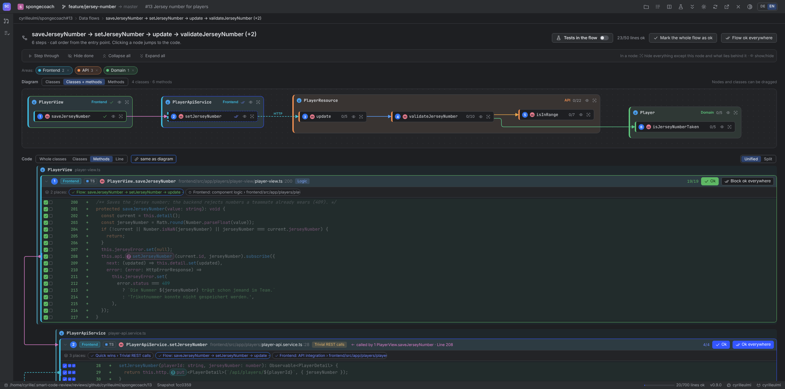

# CodeReviewLens

Code review **by meaning instead of by file**. CodeReviewLens loads your open pull requests from **GitHub** and merge
requests from **GitLab** (gitlab.com or self-managed), splits every change into meaningful units and sorts them so you
review what belongs together, in the order it runs:

- **Quick wins:** generated code, translations, DTOs, mappers, imports … gathered to check off quickly.
- **Data flows:** changed functions that call each other, in call order, as a call graph and a sequence diagram with the
  code below. Flows cross REST, from the frontend into the backend.
- **Architecture, tests, overview:** layers, components, linked tests, coverage, metrics and fitness functions.

Pattern-based and deterministic: **no AI**, no code leaves your machine except to talk to your code host.



## Start

Each command is one line and works the same in bash, zsh and PowerShell. Then open **http://localhost:8080**.
Stop with Ctrl+C; your connections and review marks stay in the volume `code-review-lens-data`.

**Without a token** – connect GitHub or GitLab in the browser («Connect a code host» in the pull request list):

```
docker run --rm -p 127.0.0.1:8080:8080 -v code-review-lens-data:/data culmi/code-review-lens:latest
```

**With your GitHub token** from the [GitHub CLI](https://cli.github.com) (`gh auth login` once):

```
docker run --rm -p 127.0.0.1:8080:8080 -v code-review-lens-data:/data -e GITHUB_TOKEN=$(gh auth token) culmi/code-review-lens:latest
```

**With a GitHub token you paste** (replace `ghp_…`; needs access to the repositories, scope `repo` for private ones):

```
docker run --rm -p 127.0.0.1:8080:8080 -v code-review-lens-data:/data -e GITHUB_TOKEN=ghp_… culmi/code-review-lens:latest
```

**With a GitLab token** for gitlab.com (replace `glpat-…`; scope `api`):

```
docker run --rm -p 127.0.0.1:8080:8080 -v code-review-lens-data:/data -e GITLAB_TOKEN=glpat-… culmi/code-review-lens:latest
```

**Self-managed GitLab** (replace the URL and `glpat-…`):

```
docker run --rm -p 127.0.0.1:8080:8080 -v code-review-lens-data:/data -e SCR_GITLAB_URL=https://gitlab.example.com -e GITLAB_TOKEN=glpat-… culmi/code-review-lens:latest
```

**GitHub and GitLab together:**

```
docker run --rm -p 127.0.0.1:8080:8080 -v code-review-lens-data:/data -e GITHUB_TOKEN=$(gh auth token) -e GITLAB_TOKEN=glpat-… culmi/code-review-lens:latest
```

Further hosts (a second GitLab, GitHub Enterprise Server) are added in the browser under «Connections».

## Keep the data in a folder

The review state is plain JSON that agents can read and write. To have it in a folder of your own instead of a volume:

```
docker run --rm -p 127.0.0.1:8080:8080 -v ${PWD}/data:/data culmi/code-review-lens:latest
```

`${PWD}` works in bash, zsh and PowerShell. On Linux the container runs as user 1001: create the folder first and make
it writable for that user (`mkdir -p data && sudo chown 1001 data`).

## Docker Compose

```yaml
services:
  code-review-lens:
    image: culmi/code-review-lens:latest
    ports:
      - "127.0.0.1:8080:8080"
    environment:
      GITHUB_TOKEN: ${GITHUB_TOKEN:-}
      GITLAB_TOKEN: ${GITLAB_TOKEN:-}
      SCR_GITLAB_URL: ${SCR_GITLAB_URL:-https://gitlab.com}
    volumes:
      - ./data:/data
```

## Configuration

All settings are optional; everything except the data directory can also be set in the browser.

| Variable | Meaning |
|---|---|
| `GITHUB_TOKEN` / `GH_TOKEN` | GitHub token |
| `GITLAB_TOKEN` / `GL_TOKEN` | GitLab token (scope `api`) |
| `SCR_GITLAB_URL` | GitLab host, default `https://gitlab.com` |
| `SCR_GITLAB_COOKIE` | Session cookies of an SSO proxy in front of GitLab (`name=value; name2=value2`) |
| `SCR_TLS_CA_CERTS` | Extra trusted certificates (PEM files or folders in the container, comma separated) |
| `SCR_TLS_INSECURE_HOSTS` | Hosts whose certificate is not checked (last resort) |

**Company CA** (self-managed GitLab with a certificate your system does not trust): the tool shows the certificate chain
and lets you trust it with one click. Or put the root certificate (PEM) into `/data/certificates`.

## Good to know

- The port is bound to `127.0.0.1` only: the API has no login of its own and is meant for your machine alone.
- Tokens entered in the browser are stored in plain text in `/data/connections.json`.
- Image: native executable (linux/amd64), about 130 MB, starts in well under a second.
- Tags: `latest` and one per release (`1.0.0`, …). Until 0.11.0 the tool was called SmartCodeReview; those images are at
  [`culmi/smart-code-review`](https://hub.docker.com/r/culmi/smart-code-review).

Source, documentation and changelog: [github.com/cyrilleulmi/code-review-lens](https://github.com/cyrilleulmi/code-review-lens)
