# SmartCodeReview (PoC)

Code review **by meaning instead of by file**. SmartCodeReview loads your open pull requests from **GitHub** and merge
requests from **GitLab** (gitlab.com or self-managed), splits every change into meaningful units (functions, types,
hunks) and sorts them so you review what belongs together, in the order it runs:

1. **Quick wins** – changes that are almost certainly irrelevant (generated code, translations, DTOs, mappers, trivial
   REST calls, imports …), ready to be checked off quickly. Detected by patterns, **without AI**.
2. **Data flows** – changed functions that call each other, in call order: a diagram on top, the code below, every call
   site connected to the code it calls. Flows also cross REST, from the frontend into the backend.
3. **Architecture** (for ports & adapters): *domain*, *use cases*, *application layer*, *adapters*; **frontend**:
   *routing*, *state*, *API access*, *forms*, *component logic*, *templates*.
4. **Single changes**, **tests**, **styles & assets**. Every changed test is linked to the code it (statically) calls:
   which components it tests and which code it reaches directly or indirectly.

Every changed line can be **checked off** – one by one, as a block, a group, a flow or a whole category. The marks live
**locally** in JSON files that agents can read and write too. Comments, resolved threads, approvals and merges go
**straight** to GitHub or GitLab.

The analysis is deterministic and pattern-based: no AI, no code leaves your machine except to talk to your code host.

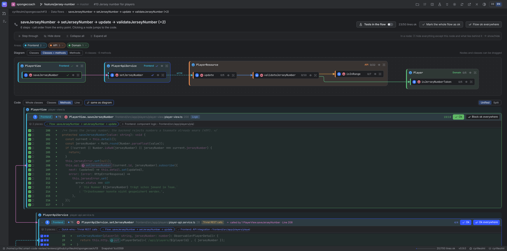

## Features

### Data flow diagrams

Each flow shows the changed functions that call each other, laid out automatically (ELK) from left to right in call
direction, with as few crossings as possible. Every layer has its own colour (frontend, API/inbound adapter, use case,
application, domain, data/outbound adapter, test), every connection its own colour – the same in the diagram, in the
line on the left of the code and in the bubble around the call itself.

The diagram has three levels of detail:

**Classes + methods** (default) – every class is a frame, its methods are small nodes inside, placed where their callers put them:

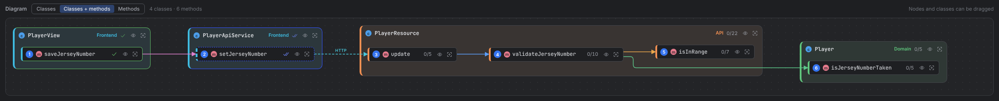

**Classes** – one node per class, the connections between classes merged:

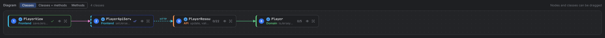

**Methods** – one node per method:

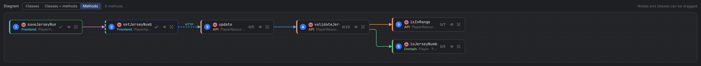

Flows cross REST: a call in the frontend (`HttpClient`, `fetch` …) is connected to the backend endpoint it hits (dashed,
labelled *HTTP*). Flows that go through several areas show them as chips; a click takes an area out of the flow. Nodes
and whole classes can be dragged, *Reset layout* brings back the automatic layout. ⌖ in a node hides everything except
that node and what lies behind it:

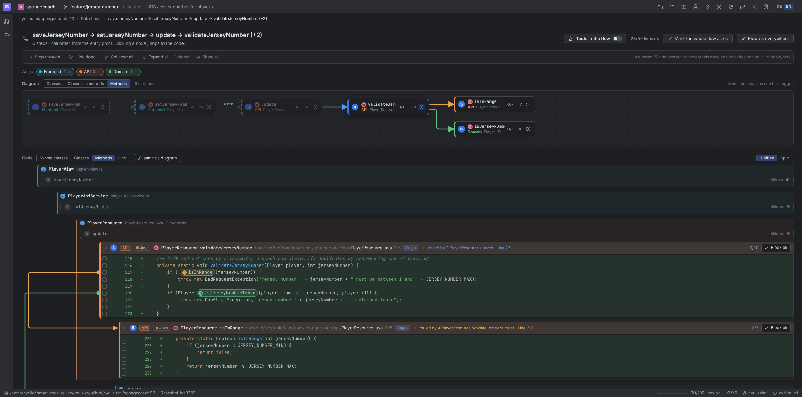

The code below the diagram follows the diagram or gets its own level: *Whole classes* (the entire file with the flow's
methods in place), *Classes*, *Methods*, or *Line* – every called block right after the line that calls it, so you read
along the call instead of finishing a method first:

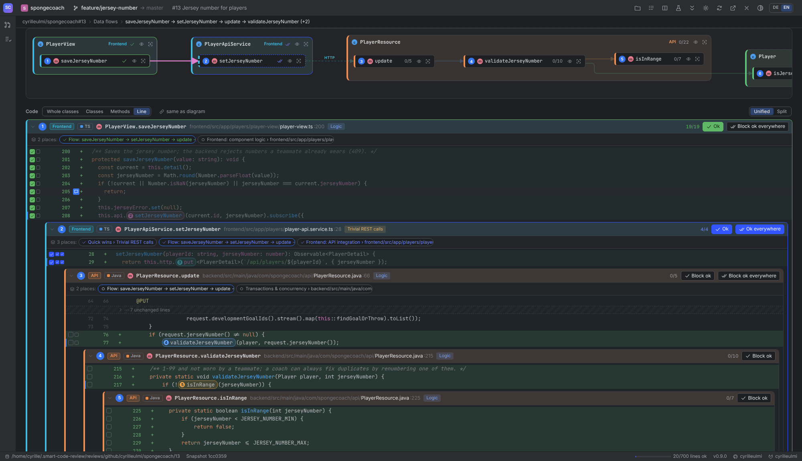

### Call sequences

A flow diagram shows who calls whom. *Sequence* (switch above the diagram) shows **in which order**: the calls of the
flow one after the other, read from the code – from the entry point, every caller line by line, each step unfolded at
its first call. On the left the calls as a list, on the right, row for row, a sequence diagram: a lifeline per class, an
arrow per call (REST calls dashed, with the request), a bar while a step runs. A step called from two lines is there
twice (*again*); the line number jumps to the call site in the code, *Calls only* leaves out constants and types.

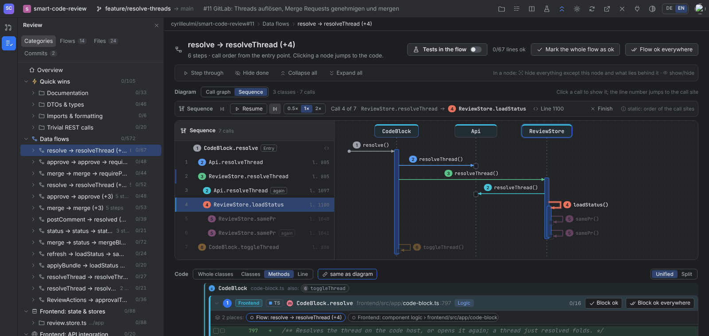

The *Sequence* bar of every flow plays the calls back (play / pause, one call back or forward, speed): in the call graph
a dot runs from the caller to the step called and what has not been reached yet stays faded, in the sequence diagram the
mark moves from arrow to arrow.

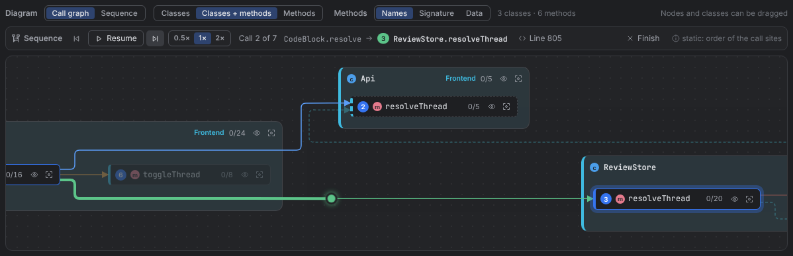

The sequence is static: it knows the order of the call sites, not conditions, loops or asynchronous calls.

### How much of a method: names, signatures, data

*Methods: Names | Signature | Data* above the diagram sets how much of every method the call graph and the sequence
show. *Signature* adds parameters and return type, in one notation for all languages
(`update(id: string, change: PlayerUpdate): Observable<PlayerDetail>`). *Data* adds the data structures below: a line
per type the method takes or returns, with its fields. On the *Classes* level the node of a class then lists its
methods one per line – a class diagram of the change:

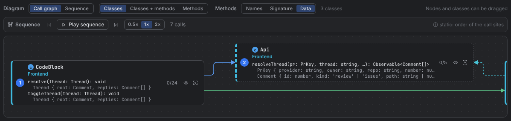

In the sequence the signature stands at the arrow and the data below it:

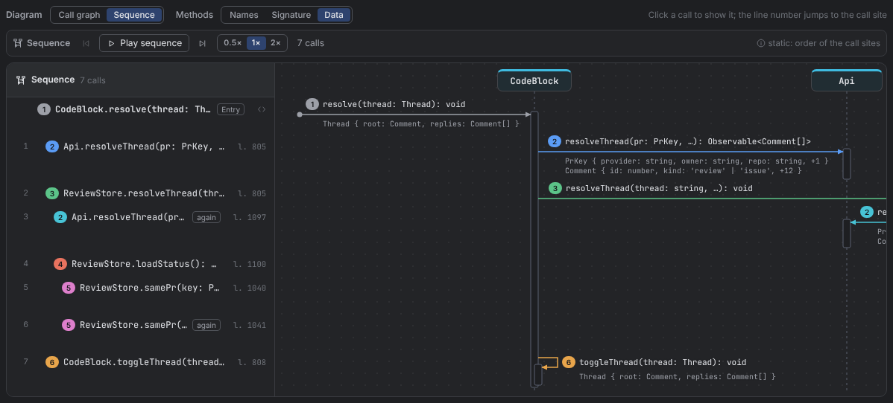

Signatures and fields are read from the declarations. A type declared in a file the pull request does not change
shows its name only.

### Overview diagrams

The overview of a pull request shows the categories with their progress, the commits, the test situation and – for
GitLab – the state of the merge request. The **component diagram** shows every changed component, each layer as a frame
around its components, laid out like the flow diagrams; ⌖ shows only one component and its dependencies. Choose a data flow
under *Sequence* to play it back there: its components stay, the rest steps back, and a dot runs from component to
component, call by call.

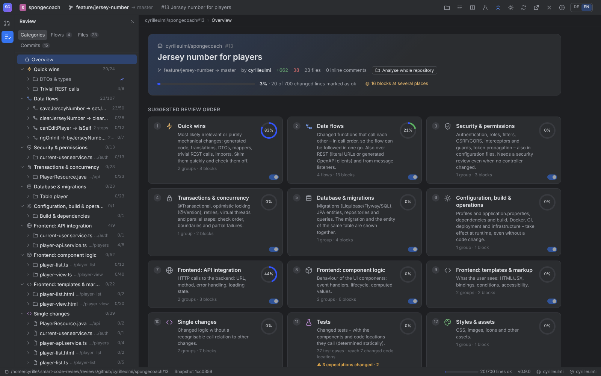

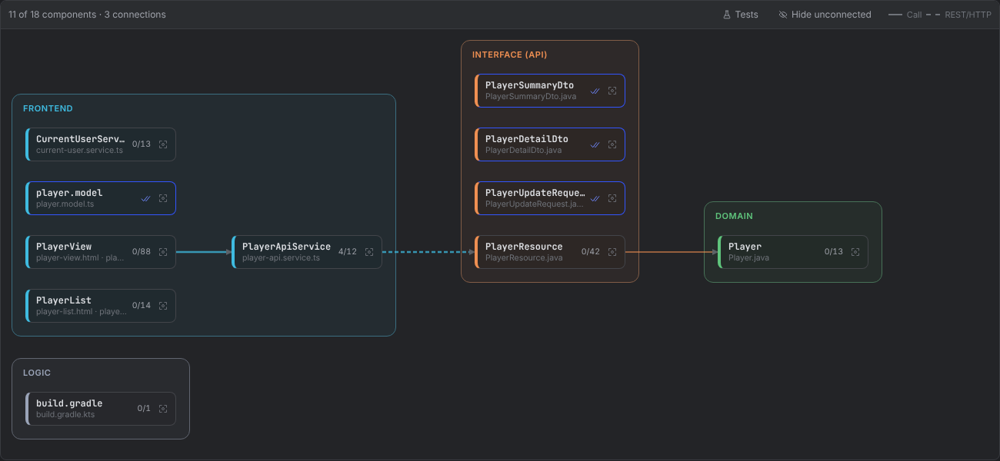

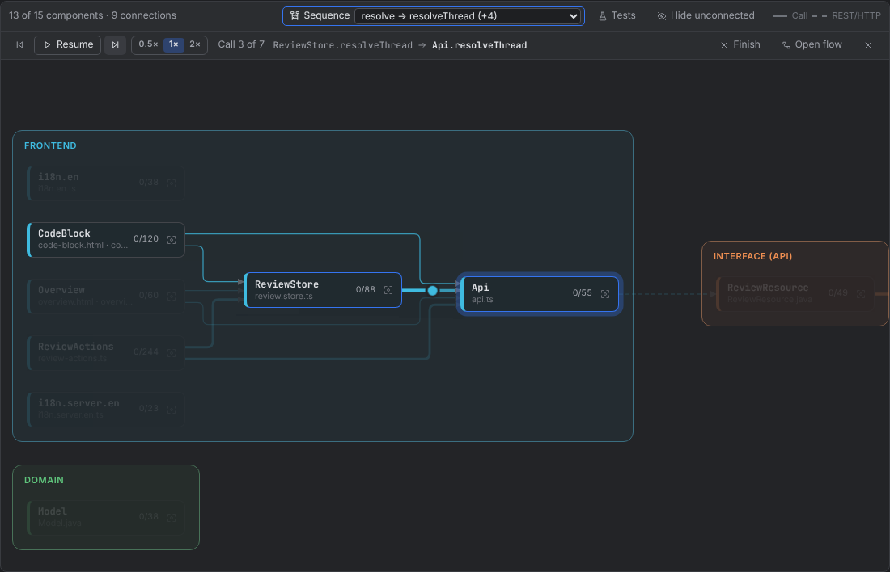

### Code review: unified and split (side by side)

Every code block shows the change in the unified (inline) view or **split**, side by side – old code on the left, new code on
the right, changed lines next to each other. Check boxes, comments, hints and blame stay at their line. Blocks with only
new or only removed lines stay single-column. The choice is stored per browser.

| Unified | Split |
|---|---|
| 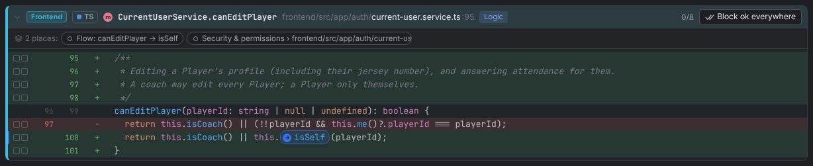 | 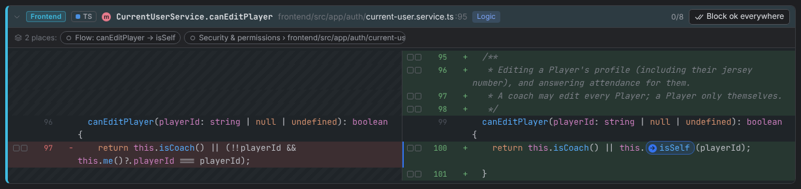 |

### Comments, threads, approve and merge

Click the speech bubble in the gutter of any line in the diff to write a comment; **Ctrl+Enter** sends it to GitHub or
GitLab immediately. Existing comments and threads are shown at their line, you can reply right there.

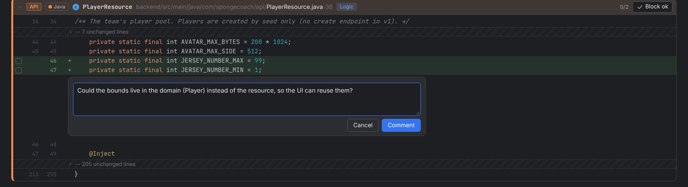

On **GitLab**, threads can be **resolved** and reopened like in GitLab itself; a resolved thread collapses into one
line. The overview of a merge request shows who approved, how many approvals are missing, the pipeline and whether the
merge request can be merged (open threads, conflicts, draft, pipeline …). **Approve**, **revoke approval** and
**merge** (with *squash commits* and *delete source branch*) act on GitLab right away – but only on the state loaded in
the tool: if GitLab has newer commits, the buttons stay locked until you reload.

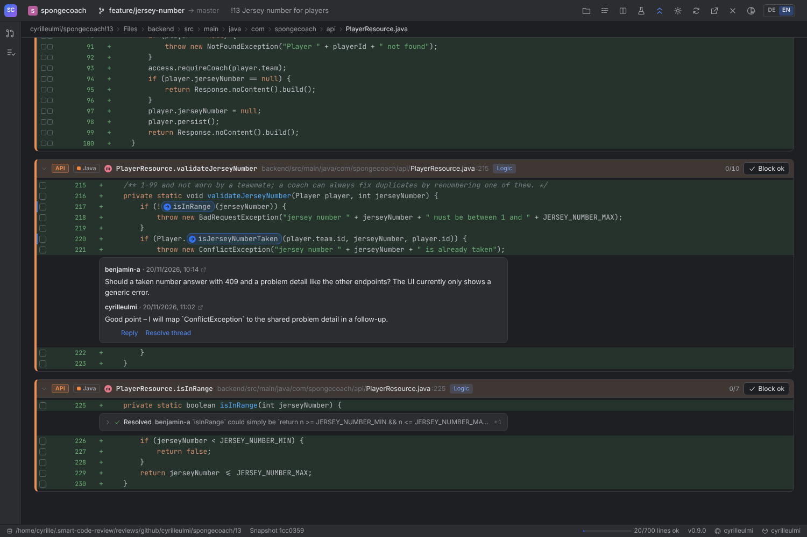

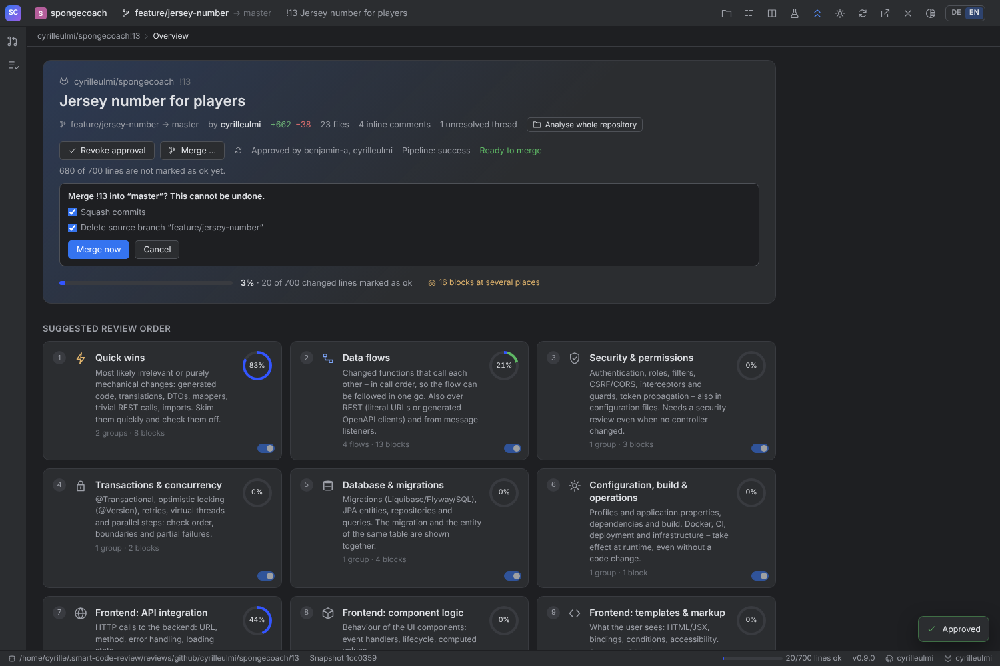

### Checking off

Every changed line has a check box in the gutter (**Shift-click** marks a range). Blocks, groups, flows and categories
have their own *ok* buttons; *Step through* goes block by block (*Ok & next*), *hide done* collapses what is finished.

A block can appear at **several places** – e.g. as a quick win and in a flow, or in two flows. It needs an OK at each
place: every line shows one box per place. **Green** means accepted at the place shown, **blue** accepted everywhere;
*Block ok everywhere* accepts all places at once. The progress bars, the review tree, the diagrams and the overview all
show the same state.

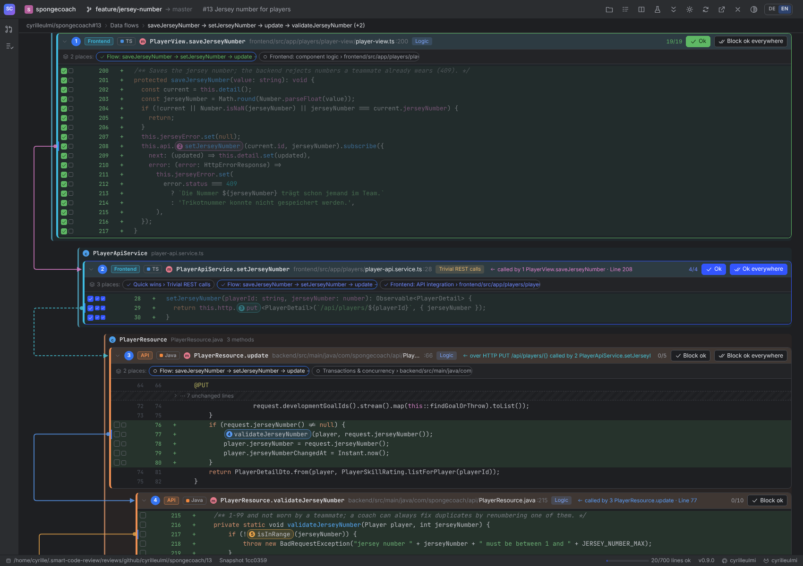

### Quick wins

Generated code, translations, DTOs and types, mappers, trivial REST calls, imports, formatting … are recognised by rules
(`rules.json`, adjustable per installation) and grouped so you can check them off in one go – each group says why its
changes are considered low-risk.

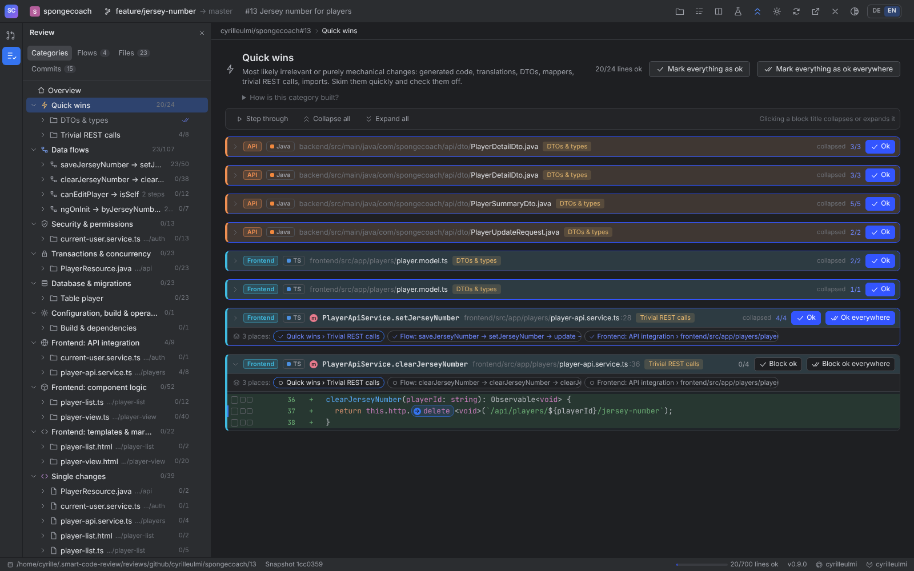

### Tests

The *Tests* category shows what the changed tests really check:

* **Specification:** the test names of every changed test file as an outline, compared with the base: new, changed,
  renamed, removed – and warnings when a test's **expectations changed**, an assertion was removed or weakened, or a
  test was disabled.
* **Coverage of the changed code:** which changed functions a test reaches directly, only indirectly or not at all,
  including existing tests that are loaded by naming convention; mocks stop the link (a mocked step is not tested).
* **Cases and effects:** error exits, boundaries and effects of the changed code that no test checks.
* **Test profile and case matrix:** normal/error/edge case, unit/integration, assertions, mocks and parametrised cases
  per test; near-identical tests as an input → expectation table.
* **Expected tests (rules)** and **test smells** (no assertion, focused, fixed sleeps, mocking the unit under test …).

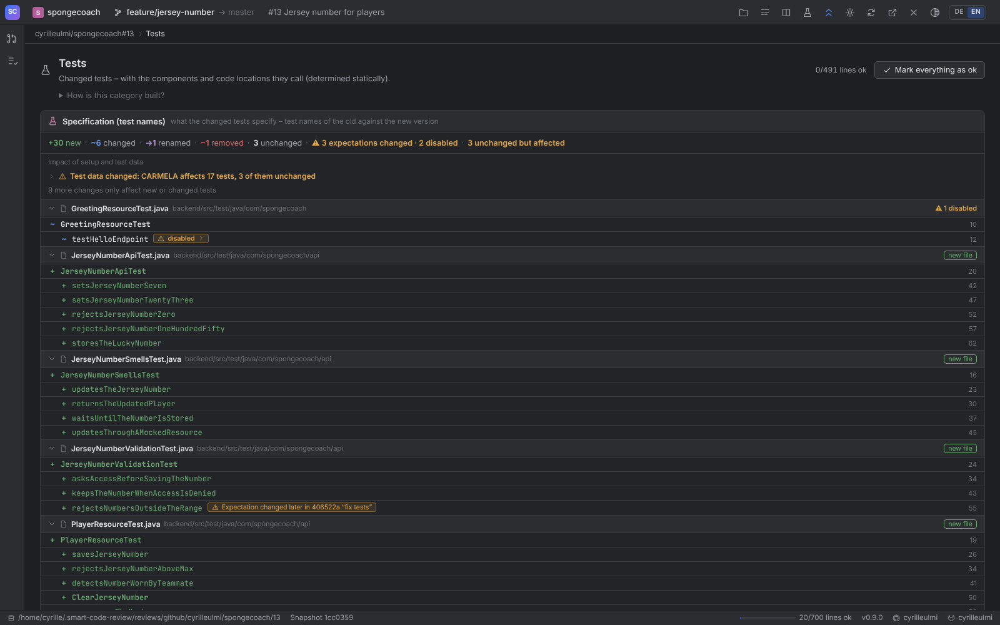

### More

* **Commits:** filter every view to one commit, step through the commits with ← →; check marks then only apply to its lines.
* **Annotate with Git Blame:** date, author and PR commit per line, like in IntelliJ.
* **Whole repository:** analyse every file of the default branch like a pull request in which every file is new.
* **Marks survive new commits:** when a pull request moves on, unchanged lines keep their marks, new and changed lines are open.
* **Dark and light theme** in the style of IntelliJ New UI, **German and English** UI.
* **Agents:** the review state lives in plain JSON files in the data directory (`~/.smart-code-review`); agents can read
  the analysis and set marks (see [docs/04-persistenz-und-agenten.md](docs/04-persistenz-und-agenten.md)).

| Light theme | Blame and commits |
|---|---|
| 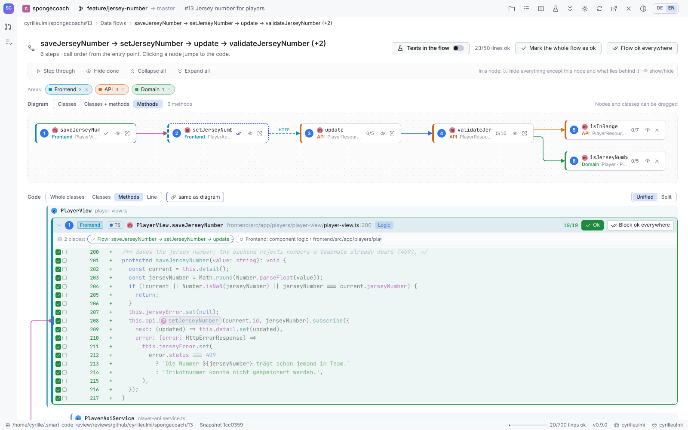 | 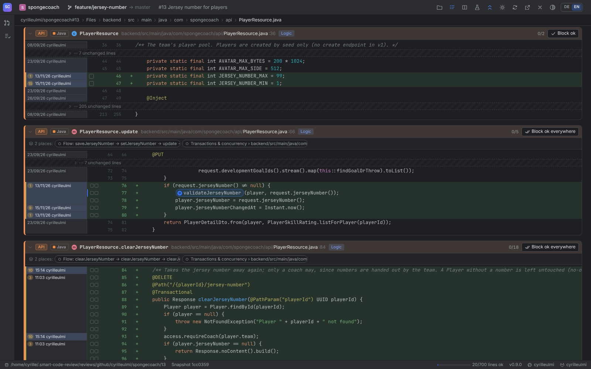 |

## Quick start (local)

Requirements: JDK 21+ (tested with 25), Node 22+ and at least one code host:

| Host | Access | Without a token |
|---|---|---|
| GitHub | `GITHUB_TOKEN` / `GH_TOKEN`, otherwise `gh auth token` | – |
| GitLab | `GITLAB_TOKEN` / `GL_TOKEN` (scope `api`), otherwise `glab config get token`; self-managed: `SCR_GITLAB_URL=https://gitlab.example.com`; behind an SSO proxy also its session cookies: `SCR_GITLAB_COOKIE="name=value; name2=value2"`. **Or everything in the UI** in the «Connections» section (see below) | Public merge requests can be opened by URL (read only) |

```powershell
# Windows
./start.ps1
```

```bash
# macOS / Linux
./start.sh
```

The script builds the Angular UI on the first run and then starts Quarkus in dev mode. Open **http://localhost:8080**.

**Connect GitHub and GitLab in the UI:** instead of environment variables, code hosts can also be connected in the
**«Connections»** section at the top of the «Pull/Merge Requests» list, several of them too: e.g. gitlab.com and a
company GitLab, github.com and a GitHub Enterprise Server. While nothing is connected, a highlighted «Connect a code host»
box shows there (GitLab or GitHub, URL, token and – behind an SSO proxy – the cookie, «Test connection», «Connect»).
Otherwise the section is a quiet list: «All» and one row per connection (host, account, number of open PRs) choose whose
pull/merge requests the list shows; the gear opens a connection's form, «Add connection» connects another host. This
applies at once and after a restart (`<data>/connections.json`). The startup configuration stays the base of the first
GitHub and the first GitLab connection: what the UI saves takes precedence field by field, «Reset to startup
configuration» discards it again; further connections can be removed. Token and cookie are stored in that file in plain
text.

**Company certificates (self-managed GitLab behind a company CA):** when the certificate of a code host is not trusted
(unknown CA, self-signed, expired, wrong host name), the request reports «Certificate of host:port is not trusted: …» and
a dialog opens with the chain the host presents and its SHA-256 fingerprints. «Trust this certificate» trusts the chosen
one (by default the topmost, usually the company CA, so other hosts of that CA work too) at once for all connections,
saved in `<data>/certificates`. «Certificates» below the connections lists what is trusted, takes a pasted PEM (e.g. the
root certificate from your IT) and shows the certificate of any host. To hand certificates over at start instead: set
`SCR_TLS_CA_CERTS` (property `scr.tls.ca-certs`) to PEM files or directories, comma separated, or put PEM files into
`<data>/certificates` (with Docker: `./data/certificates`). As a last resort, the check can be switched off per host
(«Connect without check (insecure)» in the dialog, or `SCR_TLS_INSECURE_HOSTS`): still encrypted, but no longer
protected against someone posing as the host.

When the cookie of an SSO proxy expires, the tool reports «HTML instead of JSON … has the cookie expired?». A click on
the GitLab account in the status bar (bottom right, with a lock) opens a field for the new cookie; no restart needed.

To open any pull/merge request (also someone else's public one), paste its URL into the search field of the pull request
list and press Enter. A **repository URL** (`https://github.com/owner/repo`, `https://gitlab.com/group/project`) opens
the **whole repository**.

### Ready-made image from Docker Hub

```powershell
docker run --rm -p 127.0.0.1:8080:8080 -v ${PWD}/data:/data `
  -e GITHUB_TOKEN=$(gh auth token) -e GITLAB_TOKEN=glpat-... culmi/smart-code-review:latest
```

Native executable (Mandrel, linux/amd64), image about 120 MB, starts in about 50 ms. All tokens are optional.

### Build the native binary yourself (Docker)

```powershell
$env:GITHUB_TOKEN = gh auth token      # optional
$env:GITLAB_TOKEN = "glpat-..."         # optional
docker compose up --build
```

The build compiles backend and UI into a native executable inside the container (Mandrel); no local GraalVM needed.
The data lives in `./data`.

### UI development with hot reload

```bash
cd backend && ./mvnw quarkus:dev      # API on :8080
cd frontend && npm start              # UI on :4200, /api is proxied to :8080
```

## Usage

| What | How |
|---|---|
| Open a PR/MR | Tool window «Pull/Merge Requests» (Alt+1), filter *All / Mine / Review*, or paste a URL + Enter |
| Navigate | Tool window «Review» (Alt+2): tabs *Categories / Flows / Files / Commits* |
| Check off a line | Box in the gutter, one per place of the line: the first one applies to the place shown, a click on another accepts the line everywhere. **Shift-click** marks a range. Green = accepted here, blue = everywhere |
| Check off a block / group / flow | «Block ok», ✓ button in the tree (on hover), «Mark the whole flow as ok»; next to them «Block ok everywhere» / «Flow ok everywhere» |
| Comment | Speech bubble in the gutter (lines in the diff only), Ctrl+Enter sends it to GitHub/GitLab right away; on GitLab «Resolve thread» / «Unresolve thread» |
| Approve / merge (GitLab) | Overview of the merge request: «Approve», «Revoke approval», «Merge …» (squash, delete source branch) |
| Follow a call | Coloured bubble around the call in the code (`② saveEvent`), a click jumps to the called block; «← called by …» in the block header |
| Classes or methods | Switches above the diagram (*Classes \| Classes + methods \| Methods*) and the code (*Whole classes \| Classes \| Methods \| Line*) |
| Call sequence | Switch *Call graph \| Sequence* above the diagram of a flow: list of calls and sequence diagram; a click on a call shows it, the line number jumps to the call site |
| Detail of the methods | Switch *Methods: Names \| Signature \| Data* above the diagram of a flow (call graph and sequence); stored per browser |
| Play a flow back | Bar *Sequence* in a flow (play / pause, ⏮ ⏭, speed 0.5× / 1× / 2×); on the overview: *Components* → *Sequence* → choose a data flow |
| Arrange the diagram | Automatic layout (ELK); drag nodes and whole classes, «Reset layout» undoes it |
| Split view | Toolbar button (two columns): old code on the left, new on the right; stored per browser |
| Hide what is done | Toolbar button: collapse fully checked blocks |
| Focus | Click a block title to collapse/expand; *Step through* (one block after the other, «Ok & next»), *Expand/collapse all*; in a flow 👁 hides a node, ⌖ shows only its branch |
| Categories | Switch on each category card of the overview: switched-off categories are hidden and need no OK |
| Components | Overview → *Components*: diagram of all changed components by layer; ⌖ shows one component and its dependencies |
| Several places | «n places» in the block header (✓ = OK there, a click jumps there) |
| Tests | Category *Tests*: specification, coverage, cases, test profile, case matrix, smells; in the code «Tested by …» / «Tests …» |
| Whole repository | Folder button in the toolbar, «Analyse whole repository» on the overview, or a repository URL in the search field |
| Commits | Review window → *Commits* or overview: a click shows only that commit's changes; ← → in the toolbar, × shows everything again |
| Blame | Toolbar button (lines icon): date, author and PR commit per line; a click filters to that commit |
| Connections | Top of the «Pull/Merge Requests» list: «All» and one row per connection filter the list, a gear per connection opens its form (URL, token, SSO cookie; test, save), «Add connection» for another GitHub or GitLab host; also via the plug button in the toolbar |
| Theme / language | Contrast button (dark/light) and *DE \| EN* switch in the toolbar, stored per browser |

## Documentation

The detailed documentation is in German:

| Document | Content |
|---|---|
| [docs/01-konzept.md](docs/01-konzept.md) | Requirements and decisions from the kick-off |
| [docs/02-annahmen.md](docs/02-annahmen.md) | Assumptions and deliberate simplifications of the PoC |
| [docs/03-architektur.md](docs/03-architektur.md) | Structure, REST API, technology |
| [docs/04-persistenz-und-agenten.md](docs/04-persistenz-und-agenten.md) | File format in the data directory, working with agents |
| [docs/05-analyse.md](docs/05-analyse.md) | How quick wins and data flows are detected without AI; `rules.json` |
| [docs/06-test-prs.md](docs/06-test-prs.md) | The test PRs in other repositories and their expected results |
| [docs/07-roadmap.md](docs/07-roadmap.md) | Possible future features, state of the previous items |
| [docs/08-versionierung.md](docs/08-versionierung.md) | Versioning, releases with `./release.sh X.Y.Z`, Docker tags |
| [docs/09-architektur-ueberblick.md](docs/09-architektur-ueberblick.md) | **For architects:** quality goals, context, building blocks, runtime views, data lifecycle, cross-cutting concepts, decisions |
| [docs/10-anforderungen.md](docs/10-anforderungen.md) | All features as requirements with acceptance criteria and evidence |
| [docs/11-verbesserungen.md](docs/11-verbesserungen.md) | Documented improvement opportunities (tests, structure, security, robustness, performance, operations) |
| [CHANGELOG.md](CHANGELOG.md) | Changes per version |

## Project structure

```
backend/    Quarkus 3.40 (Java 25): GitHub/GitLab access, analysis, data storage, REST API, serves the UI
frontend/   Angular 22 (standalone, signals, zoneless): UI in the IntelliJ "New UI" look
docs/       Concept, assumptions, architecture, formats, requirements, improvements, roadmap
Dockerfile  Native build (Node → Mandrel → ubi9-micro)
```
