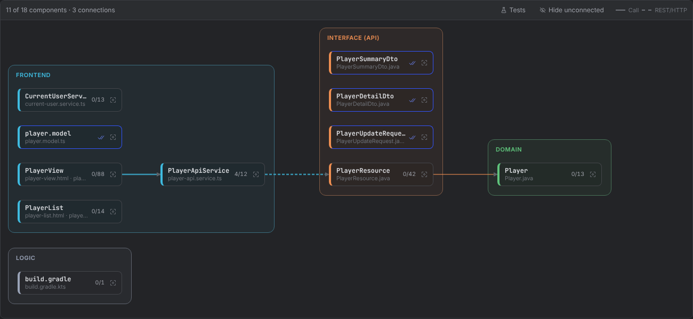
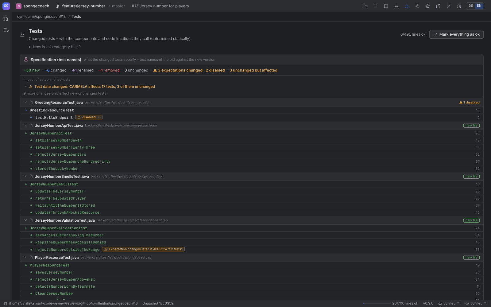
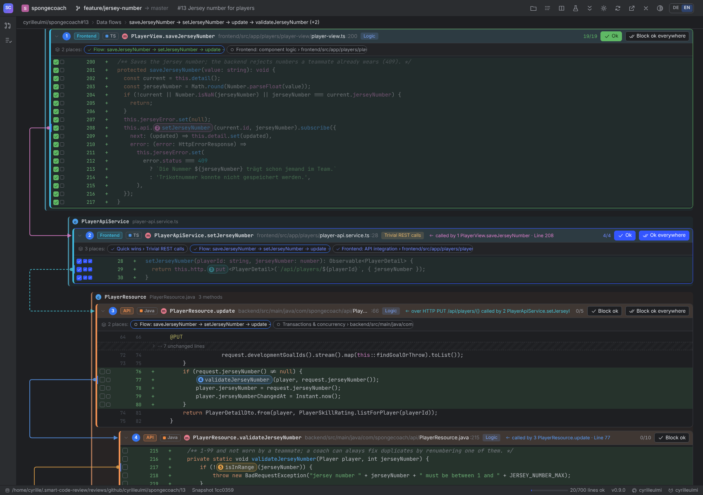

# Analyse ohne KI

Die gesamte Einteilung ist deterministisch: gleicher PR + gleiche Regeln = gleiches Ergebnis. Grundlage sind der Diff von GitHub und der Quelltext der neuen Dateiversion.

## 1. Segmente bilden

Für jede geänderte Datei:

1. **Pfad-Regel passt** (z. B. `**/package-lock.json`, `**/i18n/**`) → jede Hunk wird ein Segment dieser Kategorie. Fertig. Ausnahme: Regeln mit `"symbols": true` (die Test-Regel) zerlegen die Datei trotzdem wie in Punkt 2, damit jeder Testfall ein eigenes Segment ist.
2. **Sprache mit Struktur** (TS/JS/Java/Kotlin/C#/Go) und Quelltext vorhanden → `SymbolExtractor` findet Funktionen, Methoden, Klassen, Interfaces, Typen, Enums und Top-Level-Konstanten mit Zeilenbereich (Kommentare und Annotationen direkt darüber gehören dazu). Jede geänderte Zeile kommt in das **innerste** Symbol, das sie enthält. Leere Zeilen schliessen sich dem Nachbarn an. Zeilen ausserhalb aller Symbole (Imports, Modul-Code) bilden pro Hunk ein «Modul»-Segment.
3. **Sonst** (HTML, SQL, gelöschte Dateien …) → ein Segment pro Hunk.

Callbacks in Objekt-Literalen innerhalb von Funktionen (`subscribe({ next: … })`) werden **nicht** als eigene Symbole behandelt, damit eine Methode nicht zerstückelt wird. Ebenso Hilfsfunktionen innerhalb eines Testfalls.

**Testfälle** sind eigene Symbolarten: `test` (`it('…')`, `test('…')`, `@Test`-Methoden, Go `TestXxx`), `suite` (`describe('…')`) und `setup` (`beforeEach` & Co.). Ihr Name ist die Beschreibung, mit den umgebenden `describe`-Blöcken: `PlayerView › jersey number › saves a new jersey number`.

## 2. Quick wins erkennen

Segmente ohne Pfad-Regel werden gegen die **Segment-Regeln** geprüft (erste passende gewinnt):

| Regel | Erkennt | Prinzip |
|---|---|---|
| `imports` | Imports & Formatierung | Alle geänderten Zeilen sind Import-/Export-Zeilen |
| `formatting` | Imports & Formatierung | Hinzugefügte und gelöschte Zeilen sind ohne Leerraum identisch (umformatiert / verschoben) |
| `jpa-repositories` | → Datenbank & Migrationen | Datei enthält `interface … extends …Repository` oder `@Query(` (`fileText`) |
| `jpa-entities` | → Datenbank & Migrationen | Datei enthält `@Entity`, `@Embeddable` oder `@MappedSuperclass` |
| `type-symbols` | DTOs & Typen | Segment ist ein `interface`, `type` oder `enum` |
| `mapper-code` | Mapper | Funktionsname wie `map…`, `to…`, `from…`, `convert…` **und** alle Zeilen sind Feldzuweisungen |
| `rest-trivial` | Banale REST-Aufrufe | Alle Zeilen sind Signatur / `http.get(...)` / `fetch(...)` / Header / `return service.x(...)`, mindestens ein echter HTTP-Aufruf |
| `type-declarations` | DTOs & Typen | Alle Zeilen sind Feld-/Typdeklarationen (`name?: string;`, `private String name;`, Annotationen) |
| `declarative-config` | Deklarative Felder & Konfiguration | Alle Zeilen sind Objekt-Literale mit festen Werten (`{ name: 'title', type: 'text' }`) |
| `logging` | Logging | Nur `console.log`/`log.info(…)` |

«Alle Zeilen» ignoriert immer Leerzeilen, reine Klammerzeilen und Kommentare.

Die Pfad-Regeln (Auszug): generierte Dateien und Lockfiles (auch `gen/`, `dist/`, `build/generated/`), Übersetzungen (`i18n/`, `locales/`, `*.po`, `messages*.properties` …), Dokumentation (`*.md`), Werkzeug-Konfiguration (`tsconfig*.json`, Linter, generische `*.yml`), DTO-Dateien (`*Dto.*`, `dto/`, `*.model.ts`, `types.ts`), Mapper-Dateien (`*Mapper.*`), Tests, Styles & Assets. Keine Quick wins, sondern eigene Kategorien: Migrationen (*Datenbank & Migrationen*), API-Verträge (`openapi*.yaml` …), Laufzeit-Konfiguration, Deployment/CI und Abhängigkeiten (*Konfiguration, Build & Betrieb*).

## 3. Aufrufe und Flüsse

1. **Kanten:** Für jede geänderte Funktion A wird ihr Rumpf (ohne Imports, ohne darin verschachtelte geänderte Funktionen) nach den Namen der anderen geänderten Funktionen/Konstanten B durchsucht. Kurze oder generische Namen (`get`, `save`, `map` …) zählen nur mit Aufrufsyntax `name(`. Über Dateigrenzen braucht es einen Import-Beleg (Modulpfad, Klassen- oder Funktionsname im Import; Java: Klassenname im Code). Ausnahme: klassische Skripte ohne Module teilen sich den globalen Scope.
   Go: Dateien im selben Ordner sind ein Paket und brauchen keinen Import. Tests rufen Produktivcode auf, aber nie umgekehrt.
2. **Hubs** (mehr als 5 Aufrufer) werden für den Zusammenhang ignoriert, damit `cn()` oder `Button` nicht alles zu einem Fluss verkleben. Kanten von Tests zählen dabei nicht.
3. **Flüsse:** Jeder Einstiegspunkt (geänderte Funktion ohne geänderten Aufrufer) bekommt einen eigenen Flow mit allem, was er erreicht – mindestens zwei Segmente, davon mindestens eines Logik. Eine gemeinsam genutzte Funktion ist deshalb Teil **mehrerer** Flows. Ausnahme: In zusammenhängenden Gruppen mit mehr als 20 Funktionen kommt jede Funktion nur im ersten Flow vor, der sie erreicht (sonst würden riesige PRs mit Duplikaten geflutet). Tests werden nie Teil eines Flows.
4. **Reihenfolge:** Tiefensuche ab dem Einstiegspunkt (kein Aufrufer im Flow; äussere Schicht zuerst), Aufrufe in Reihenfolge ihrer Zeile. Daraus entstehen Schrittnummer und Tiefe für Diagramm und Einrückung.
5. **Titel:** Kette der ersten Schritte, z. B. `update → validateJerseyNumber → isJerseyNumberTaken`. Beginnt der Flow an einem Endpunkt oder Listener, steht der Auslöser davor: `PUT /rest/players/{}: updatePlayer → …`, `JMS-Listener: onMessage → readEvent → applyEvent`.

## 3b. Über REST ins Backend

Für jedes Segment werden HTTP-Aufrufe mit literaler URL gesucht (`this.http.put<T>(`/api/players/${id}`, …)`, `fetch('/api/x', { method: 'POST' })`, `axios.get(…)`), für jede Methode die Endpunkte (`@Path("/api/players")` an der Klasse + `@PUT @Path("/{playerId}")` an der Methode, `@GetMapping`, Next.js `app/api/…/route.ts` mit `export async function PUT`, `app.put('/x', …)`, `HandleFunc("PUT /x", …)`). Passen Methode und Pfad (Parameter = Platzhalter), entsteht eine Kante der Art `http`. Damit läuft ein Flow z. B. so: `PlayerView.saveJerseyNumber → PlayerApiService.setJerseyNumber ⇢ PUT /api/players/{} ⇢ PlayerResource.update → validateJerseyNumber → Player.isJerseyNumberTaken`.

**Generierte Clients (OpenAPI):** Ruft das Frontend einen generierten Service auf (`this.playersService.updatePlayer(id, body)`), steht keine URL im Code. Dafür liest die Analyse die Verträge des Repos (`openapi*.yaml`, `swagger.json` …) und kennt jede Operation mit operationId, Methode und Pfad (inkl. `servers: - url: /rest`). Ein Aufruf `.updatePlayer(` wird so zu `PUT /rest/players/{}`; das Gegenstück ist eine Methode `updatePlayer` in einer Klasse, die das generierte Interface implementiert (`class PlayerController implements PlayersApi`), oder ein Spring-/JAX-RS-Endpunkt mit passendem Pfad. Die Kante heisst dann `PUT /rest/players/{} (updatePlayer)`. Geänderte Zeilen im Vertrag (Kategorie *API-Verträge*) verweisen auf die geänderten Aufrufer und Implementierungen derselben Operation.


## 3c. Architektur und Frontend

* **Ports & Adapters:** Die Ordner des ganzen Repos werden einmal geladen (`structure.json`). Gibt es Rand- und Kern-Ordner (siehe Annahme B14), bekommt jedes Code-Segment eine Schicht und erscheint zusätzlich in *Domäne*, *Use Cases*, *Application Layer* oder *Adapter* (eingehend / ausgehend / weitere).
* **Frontend:** Segmente in Frontend-Dateien werden gegen die `aspects`-Regeln geprüft (erste passende): Routing, Zustand, API-Anbindung, Formulare, Komponenten-Logik, Templates. Bedingungen: `paths`, `kinds`, `symbol`, `text` (Muster im Code des Segments), `fileText` (Muster irgendwo in der Datei), `special: "markup"` (mehrheitlich HTML/JSX-Zeilen).
* **Schichten mit Adaptern (Onion-Stil):** Hat das Repo `domain`, `application` und `adapter`, aber keine Ports/Use Cases, heisst der Stil `layered`. Die Kategorien sind dieselben; Adapter werden nach Rolle gruppiert (eingehend inkl. Message-Listener, ausgehend, Mapping, Konfiguration).
* **Querschnitt (`concerns`):** Sicherheit & Berechtigungen, Messaging & Events, Transaktionen & Nebenläufigkeit, Datenbank & Migrationen – für Frontend und Backend, **alle** passenden Regeln zählen. Funktionen werden mit ihren Annotationen geprüft (`@Transactional`, `@JmsListener`, `@PreAuthorize` …), Konfigurationsdateien zeilenweise (`spring.jms…`, `…cors…`, `ddl-auto`).
* **Schema:** Migrationen und Entities, die dieselbe Tabelle nennen, stehen in *Datenbank & Migrationen* in der Gruppe «Tabelle x» und verweisen aufeinander.
* Alles das sind **zusätzliche Orte** mit eigenem Ok. Regeln mit `"extras": false` (Generiert, Imports, Tests, Styles …) bekommen keine.

## 3d. Komponenten

Geänderte Code-Dateien gleichen Namens im gleichen Ordner bilden eine Komponente (`player-view.ts/.html/.scss`). Jede bekommt eine Spalte (Frontend, Adapter ein, API, Use Cases, Application, Logik, Adapter aus, Daten, Domäne, Tests); die Aufruf- und REST-Kanten zwischen ihren Segmenten werden zu `componentEdges` zusammengefasst. Die Übersicht zeigt daraus das Komponentendiagramm.



## 3e. Kategorien als Module

Jede Kategorie ist ein eigenes **Modul** (`CategoryModule`) mit derselben Schnittstelle:

| Methode | Zweck |
|---|---|
| `id()`, `info()` | Name, Icon und **Selbstbeschreibung**: `summary` (wofür), `builds` (wie sie aufgebaut ist: welcher Code hier landet und warum), `divides` (wie sie in Gruppen unterteilt wird). Das UI zeigt `builds`/`divides` unter dem Titel der Kategorie («Wie entsteht diese Kategorie?») und als Tooltip in der Übersicht. |
| `groups(context)` | Die Gruppen der Kategorie, berechnet aus `SegmentFacts` (Pfad, Regel-Kategorie und -Gruppe, Schicht, Frontend-Aspekt, Querschnittsthemen, Adapter-Richtung, «Teil eines Flusses») und den Flüssen. |
| `view()` | `groups` (Standard: Liste von Gruppen mit Code-Blöcken) oder eine **Ausnahme mit eigener Ansicht**: `flow` (Aufrufdiagramm, Blöcke in Aufrufreihenfolge), `tests` (Gruppen plus Spezifikation der Testnamen, Abdeckung des geänderten Codes und Testübersicht, Abschnitte 5a–5c). Das UI entscheidet danach, nicht nach der Kategorie-Id. |
| `origin()` | `builtin` (fest eingebaut, z. B. Datenflüsse), `rules` (aus der Regeldatei); später `external`. |

**Entkoppelt:** Ein Modul kennt kein anderes Modul und den `Analyzer` nicht. Hinzufügen oder Entfernen einer Kategorie ändert nur ihre eigene Liste; ein Segment, das mehrere Module beanspruchen, wird einfach in jedem zu einem eigenen Ort (Abschnitt 4). Die Module werden aus den Kategorien der Regeldatei erzeugt (`CategoryModules`): Kategorie mit Regeln → Regel-Gruppen; `domain`/`usecases`/`application`/`adapters` → zusätzlich die Architektur-Schicht; Kategorie mit `aspects` → Frontend-Aspekt; mit `concerns` → Querschnittsthema; `flows` → eine Gruppe pro Fluss mit eigener Ansicht; `logic` → der Rest ausserhalb von Flüssen.

**Beschreibung:** `builds` und `divides` werden aus den Regeln abgeleitet (Regel-Gruppen mit ihrem Grund, Aspekte, Querschnittsthemen), stimmen also auch bei eigenen Regeln. Wer es anders formulieren will, setzt `"builds"` / `"divides"` an der Kategorie in `rules.json`.

**Später von aussen (noch nicht umgesetzt):** Das Modul bekommt nur `SegmentFacts` und liefert nur `Group`s, ohne gemeinsamen Zustand. Damit kann ein Modul von ausserhalb der Anwendung geliefert werden. `CategoryModules.build(rules, additional)` nimmt dafür bereits zusätzliche Module entgegen (Ids dürfen nicht doppelt vergeben werden); Gruppen-Ids beginnen mit `<id>/`. Es gibt noch keine Quelle für solche Module und nichts, das sie lädt.

## 4. Orte

Jede Gruppe, die ein Segment zeigt, ist ein **Ort** (`segments[].places`): die Gruppe seiner Kategorie (ausser Logik, die in einem Flow liegt – die steht nur dort) und jeder Flow, der es enthält. Beispiel: `PlayerApiService.setJerseyNumber` ist ein banaler REST-Aufruf *und* der letzte Schritt von `saveJerseyNumber → setJerseyNumber` → zwei Orte, zwei Oks.

**Eine Zeile an mehreren Orten** (`review/LineAcceptance`, im UI gespiegelt in `acceptance.ts`):

* Jeder Ort braucht sein eigenes Akzeptieren. Eine Zeile ist **akzeptiert**, sobald sie an allen ihren Orten akzeptiert ist.
* Ist sie an einem Ort akzeptiert, gilt sie an jedem anderen Ort als **halb akzeptiert**: Das Häkchen ist halb gefüllt, daneben steht der Hinweis «bereits an anderem Ort akzeptiert» (bei mehreren: «an *n* anderen Orten»; einmal pro zusammenhängendem Lauf solcher Zeilen, nicht auf jeder Zeile), der Tooltip nennt die Orte, ein Klick darauf springt zum ersten. Halb akzeptiert zählt im Fortschritt noch **nicht**; mit einem Klick auf das Häkchen wird sie auch hier akzeptiert.
* Mehrere akzeptierte Orte werden einzeln geführt. Nimmt man an einem Ort das Akzeptieren zurück, bleiben die anderen Orte akzeptiert (auch bei einer sonst überall akzeptierten Zeile).
* Eine Markierung ohne Ort (Dateiansicht, Agenten) oder auf einem Ort, an dem die Zeile nicht vorkommt, gilt für alle Orte auf einmal. Zeilen mit nur einem Ort kennen den Halbzustand nicht.
* Ausgeschaltete Kategorien zählen nicht als Ort. «Halb akzeptiert» ist abgeleitet und steht nicht in `review.json`; das Dateiformat (`ok`, `okAt`) ist unverändert.

## 5. Tests verknüpfen

Für jeden geänderten Testfall wird der Aufruf-Graph ab dem Test durchlaufen (Breitensuche, bis 4 Ebenen):

* Erreicht er eine geänderte Funktion direkt (oder über eine Hilfsfunktion in der Testdatei) → **direkt**, mit der Zeile im Test.
* Von dort aus weiter erreichte geänderte Funktionen → **indirekt**, mit dem Segment, über das sie erreicht werden.
* **Komponenten:** die Datei nach Namenskonvention (`PlayerResourceTest.java` → `PlayerResource.java`, `player-view.spec.ts` → `player-view.ts`; bevorzugt gleiche Sprache) und die Klassen/Dateien des direkt aufgerufenen Codes.

Beispiel spongecoach#13: `PlayerResourceTest › savesJerseyNumber` → `PlayerResource.update` (direkt, Testzeile 28) → `validateJerseyNumber` (über update) → `Player.isJerseyNumberTaken` (über validateJerseyNumber).



### 5a. Abdeckung aus Sicht des Codes

Die Testübersicht zeigt, was ein Test erreicht. Die **Abdeckung** dreht die Sicht um: Welche geänderte Logik erreicht *kein* geänderter Test? Sie steht in `analysis.json` unter `coverage[]` (ein Eintrag pro testbarer Funktion) und im UI über der Testübersicht der Kategorie Tests.

**Testbar** ist ein Segment, wenn es eine geänderte Funktion, Methode oder Komponente ist (`symbolKind` `function`, `method`, `component`; keine Testfälle, Testhilfen oder Setup-Blöcke), mindestens eine nicht triviale Zeile geändert hat (nicht nur Leerzeilen, Kommentare, Klammern) und seine Hauptkategorie Tests braucht: `needsTests` an der Kategorie in der Regeldatei, Default `true`. In den Standardregeln steht `false` bei `quick-wins`, `tests`, `styles`, `api-contract` und `runtime` (Mechanisches und Konfiguration). `persistence` braucht Tests: Entities enthalten oft echte Logik (z. B. `Player.isJerseyNumberTaken`). Methoden, die nur Frameworks aufrufen (`constructor`, `ngOnInit`, `render`, `main`, `GET`/`POST` …), fehlen ebenfalls: Kein Test ruft sie beim Namen auf, sie stünden immer unter «Ohne Test».

**Triviale Zugriffsmethoden** fehlen in jeder Kategorie: Getter und Setter (Java `getX`/`setX`, TS `get`/`set`), deren Rumpf nur aus einer einzigen Anweisung besteht – `return this.x;`, `return x;` (auch mit einem Empfänger wie Gos `return p.x`), `this.x = x;` oder `x = value;`. Geprüft wird der Code ohne Kommentare und Strings zwischen der ersten `{` und der letzten `}` der Funktion; die Signatur und die Klammern zählen also nicht. Alles andere bleibt drin: ein Literal (`return "fix";`), ein Aufruf (`return repo.find(id);`), eine Rechnung, eine zweite Anweisung, Funktionen ohne geschweifte Klammern (Pfeilfunktionen, Kotlins `get() = field`) – im Zweifel lieber einmal zu viel in der Liste als echte Logik versteckt.

| Feld | Bedeutung |
|---|---|
| `status` | `direct`: ein geänderter Test ruft die Funktion auf (auch über Hilfsfunktionen der Testdatei). `indirect`: nur über anderen geänderten Code erreicht. `none`: kein geänderter Test erreicht sie. |
| `directTests`, `indirectTests` | Ids der Test-Segmente, aus den Verknüpfungen von Abschnitt 5. |
| `branches` | Entscheidungen in der **ganzen** Funktion, gezählt auf dem Code ohne Strings und Kommentare: `if` (auch `else if`, einmal), `elif`, `case`, `catch`, `except`, `for`, `while`, `&&`, `\|\|` und das `?` eines ternären Ausdrucks. Als ternär zählt nur ein `?` mit Leerraum (oder Zeilenende) auf beiden Seiten; so zählen `?.`, `??`, `?:` (TS-optional, Kotlin-Elvis), `<?>` und `String?` nicht. Nicht gezählt: `else`, `default`, Kotlins `when`-Zweige, Pythons `and`/`or`. |
| `changedLines` | Geänderte Zeilen des Segments ohne Leerzeilen, Kommentare und reine Klammern. |
| `risk` | `changedLines × (1 + branches)` – viel Geändertes mit vielen Verzweigungen zuerst. Nur zum Sortieren. |

Sortiert ist die Liste nach Status (`none`, dann `indirect`, dann `direct`) und darin nach `risk` absteigend. Wie die Verknüpfung selbst ist alles **statisch**: Es zählen nur geänderte Tests und geänderter Code, Aufrufe über HTTP oder Reflection werden nicht gesehen, und «direkt getestet» heisst «aufgerufen», nicht «jeder Zweig geprüft».

**Im UI:** Die Kategorie Tests hat die Ansicht `tests` (`view()`): über der Testübersicht steht «Abdeckung des geänderten Codes» mit einer Zusammenfassung und den Funktionen in den Gruppen «Ohne Test», «Nur indirekt getestet» und «Direkt getestet» (eingeklappt). Klick auf eine Zeile springt zum Code, Klick auf einen Test zum Test. Ändert ein PR Code, aber keinen Test, gibt es die Kategorie Tests nicht; dann führt die Kachel «Abdeckung des geänderten Codes» auf der Übersicht (und der Eintrag «Abdeckung» im Review-Baum) auf eine eigene Seite. Jeder testbare Block trägt im Kopf ein Abzeichen: «ohne Test», «nur indirekt getestet» oder «n Tests».



### 5b. Spezifikation (Testnamen)

Viele PRs bestehen zu einem guten Teil aus Tests. Bevor man Testcode liest, will man wissen, **welches Verhalten** die Tests festlegen und was sich daran geändert hat. Dafür zeigt die Kategorie Tests ganz oben die Testnamen jeder geänderten Testdatei als Gliederung (Suite › Suite › Test), als Diff gegen die Basisversion. In `analysis.json` steht das unter `specs[]` (eine `SpecFile` pro Testdatei, nach Pfad sortiert; Code in `analysis/Specs`).

**Welche Dateien:** Testdateien nach der Pfadregel der Kategorie `tests` (`*.spec.*`, `*Test.java`, `test/**` …) in einer Sprache mit Symbolen, mit Patch. Dateien ohne einen einzigen Testfall (Hilfsklassen, Fixtures) fehlen.

**Alte Version:** Für geänderte, umbenannte und gelöschte Testdateien wird der Inhalt am Basis-Commit des PRs (`baseSha`) geladen – bei umbenannten Dateien unter dem alten Pfad – und unter `sources-base/<alter Pfad>` gespeichert, einmal beim Laden des PRs (bzw. bei der ersten Analyse für ältere Snapshots). Schlägt das fehl, steht `baseAvailable: false` und die Gliederung zeigt nur die neue Seite («Basisversion nicht verfügbar – nur neue Seite»). Beim ganzen Repository (Nummer 0) gibt es keine Basis und damit keinen Spec-Diff (`specs` ist leer): Jeder Test wäre «neu», die Gliederung riesig und ohne Aussage.

**Einträge:** Suites und Testfälle kommen aus der Symbolerkennung (Arten `suite`, `test`; Abschnitt 5). Eine Klasse, die einen Testfall enthält, gilt als Suite – bei JUnit also die Testklasse und ihre `@Nested`-Klassen. Die Verschachtelung ergibt sich daraus, welcher Bereich welchen umschliesst; `suites` nennt die umschliessenden Suites von aussen nach innen, `depth` die Einrückung.

**Abgleich** zwischen alter und neuer Version, deterministisch in dieser Reihenfolge:

1. **Gleicher Pfad** (Art + Suite-Kette + Name) → derselbe Eintrag. Gibt es denselben Pfad mehrmals, werden sie in Dateireihenfolge gepaart. Status `changed`, wenn im PR-Diff eine geänderte Zeile im Bereich des Eintrags liegt (neue oder alte Seite; Leerzeilen und reine Klammerzeilen zählen nicht), sonst `unchanged`.
2. **Umbenannte Suites:** Eine entfernte und eine neue Suite derselben Datei, deren Text ohne Leerraum und ohne den eigenen Namen identisch ist, sind eine Umbenennung (`renamed`, `previousName`). Danach werden die alten Pfade darunter auf den neuen Namen umgeschrieben und Schritt 1 wiederholt – die unveränderten Tests einer umbenannten Suite bleiben so `unchanged`.
3. **Umbenannte Tests:** dasselbe für Testfälle. Gepaart wird in alter Dateireihenfolge, jeweils mit dem ersten freien neuen Eintrag (neue Dateireihenfolge) mit gleichem Text. Liegt der Test jetzt in einer anderen Suite, enthält `previousName` den alten Pfad mit « › ».
4. Der Rest ist `added` (nur neu) oder `removed` (nur alt). Eine Suite ist also `added`/`removed`, wenn sie ganz neu ist oder ganz fehlt; sonst `changed`, sobald darin etwas geändert ist.

Ändert man den Namen **und** den Inhalt, ist das keine Umbenennung, sondern «entfernt» + «neu». Wird eine Suite umbenannt und darin ein Test geändert, erscheint die ganze Suite als entfernt und neu (der unveränderte Teil wird dann über Schritt 3 trotzdem als umbenannt erkannt).

**Reihenfolge:** Einträge stehen in der Reihenfolge der neuen Datei. Ein entfernter Eintrag steht hinter seinem vorherigen Geschwister aus der alten Datei (und hinter dessen Kindern), sonst als erstes Kind seiner Suite, sonst ganz oben. Entfernte Kinder einer entfernten Suite folgen ihr in alter Reihenfolge.

**Ohne Basisversion** werden nur die Einträge der neuen Datei gezeigt; der Status kommt dann aus dem Diff allein: `added`, wenn alle nicht trivialen Zeilen hinzugefügt sind, `changed` bei sonstigen geänderten Zeilen (auch gelöschten) im Bereich, sonst `unchanged`. Entfernte und umbenannte Tests sind so nicht erkennbar.

| Feld (`SpecEntry`) | Bedeutung |
|---|---|
| `name`, `suites`, `kind` | Name, umschliessende Suites (aussen zuerst), `suite` oder `test`. |
| `status` | `added`, `removed`, `changed`, `renamed`, `unchanged`. |
| `previousName` | Bei `renamed` der alte Name (bzw. der alte Pfad, wenn sich die Suites geändert haben). |
| `segmentId` | Das Segment dieses Eintrags, wenn er geänderte Zeilen hat; `null` bei entfernten und unberührten Einträgen. |
| `line`, `oldLine` | Startzeile in der neuen bzw. alten Datei (`null`, wo es die Seite nicht gibt). |
| `depth` | Einrückung in der Gliederung. |
| `expectations` | Geänderte Erwartungen gegenüber der Basisversion (Abschnitt 5c); leer bei neuen und entfernten Einträgen und ohne Basisversion. |
| `assertionsBefore`, `assertionsAfter` | Anzahl Assertion-Anweisungen im Testrumpf, alt bzw. neu (`null` bei Suites und wo es die Seite nicht gibt). |
| `disabled` | Der Eintrag ist jetzt ausgeschaltet (selbst oder über eine umschliessende Suite); `false` bei entfernten Einträgen. |

**Im UI:** «Spezifikation (Testnamen)» steht in der Kategorie Tests über der Abdeckung: eine Zusammenfassung über alle Testfälle (z. B. «+6 neu · ~2 geändert · →1 umbenannt · −1 entfernt · 14 unverändert»; Suites zählen nicht) und pro Datei eine einklappbare Gliederung mit Markierung pro Eintrag: `+` neu, `~` geändert, `→` umbenannt mit «vorher: …», `−` entfernt (durchgestrichen). Unveränderte Einträge sind blass und hinter «n unveränderte anzeigen» versteckt; eine unveränderte Suite bleibt sichtbar, solange darunter etwas geändert ist. Ein Klick auf einen Eintrag mit Segment springt zum Testcode; ein entfernter Eintrag öffnet die Dateiansicht beim Block mit den gelöschten Zeilen (gesucht wird die Zeile `O<oldLine>` und die zwei folgenden), sonst ist er nicht klickbar.

### 5c. Geänderte Erwartungen

«Geändert» allein sagt nicht, **was** sich an einem Test geändert hat. Gefährlich ist der Fall, in dem ein PR bestehende Tests an kaputten Code anpasst: ein anderer erwarteter Wert, eine entfernte oder abgeschwächte Assertion, ein ausgeschalteter Test. Dafür vergleicht der Spec-Diff bei jedem gepaarten Eintrag (gleicher Pfad oder umbenannt) die Assertions der alten mit denen der neuen Version (Code in `analysis/Expectations`, Muster in den Regel-Abschnitten `assertions`, `weakAssertions`, `disabledTests`). Alles musterbasiert und deterministisch, ohne KI.

1. **Assertion-Anweisungen:** Eine Zeile des Testrumpfs, deren Code (Strings und Kommentare ausgeblendet) ein `assertions`-Muster enthält, beginnt eine Assertion – etwa `expect(`, `assertEquals(`, `assertThat(`, `verify(`, `t.Errorf(`, `assert.Equal(`, RestAssured `.statusCode(` / `.body("pfad", …)`, MockMvc `.andExpect(`, Angular `httpMock.expectOne(` / `expectNone(`, Kotest `x shouldBe 3`. Sie reicht über die folgenden Zeilen, solange Klammern offen sind, und über Fortsetzungszeilen, die mit `.` beginnen und selbst keine Assertion sind (`expect(x)` ⏎ `.toBe(1)`, AssertJ-Ketten). Von der Deklarationszeile zählt nur der Teil nach dem ersten `{` bzw. `=>` – ein Test namens `verifySaved` oder `shouldBeCreated` ist keine Assertion. Verglichen wird ohne Leerraum, ohne `;` am Ende und ohne Komma vor einer schliessenden Klammer: Umformatieren ist keine Änderung.
2. **Gegenstand** (was geprüft wird), bestimmt am Aufruf, den das Muster gefunden hat:
   * **Verketteter Matcher** (das Muster beginnt mit `.`, z. B. `.statusCode(…)`, `.body("name", …)`, `.andExpect(…)`): der Text davor, der Aufruf und alle Argumente ausser dem letzten – `.statusCode(200)` → `.statusCode(201)` ist also eine geänderte Erwartung.
   * **Gleichheit** (`assertEquals`, `assertNotEquals`, `assertSame`, `assertArrayEquals`, `assertIterableEquals`, testify `Equal`, `EqualValues`, `Exactly`, `JSONEq`, `ElementsMatch`, `InDelta` …; nur `assert…`-Namen, unqualifizierte Aufrufe und testify): der tatsächliche Wert, also das **zweite** Argument (erwartet kommt zuerst), das dritte, wenn das erste ein String ist (JUnit 4 mit Meldung vorne). JavaScripts `assert.equal(actual, expected)` hat die umgekehrte Reihenfolge und fällt deshalb unter die nächste Regel.
   * **Sonst** der Aufruf mit seinem ersten Argument: `expect(score(3))`, `assertThat(player.getName())`, `verify(repo)`, `assertNull(x)`.
   * Ein Go-Testhandle als erstes Argument (`t`, `b`, `s.T()`) wird übersprungen. Infix-Matcher ohne Klammern (Kotest): der Text vor dem Matcher.
3. **Paaren:** Zuerst identische Anweisungen (in Reihenfolge), dann übrige mit gleichem Gegenstand (in Reihenfolge).
   * `changed`: gleicher Gegenstand, anderer erwarteter Wert oder Matcher.
   * `weakened`: wie `changed`, aber die neue Anweisung passt auf ein `weakAssertions`-Muster und die alte nicht (`toEqual('Ann')` → `toBeTruthy()`, `isEqualTo(…)` → `isNotNull()`); oder eine Assertion ist weggefallen und der Test hat nur noch schwache.
   * `removed` / `added`: ohne Partner. Bei einem **entfernten Test** wird nicht jede Assertion einzeln gelistet, nur `assertionsBefore`.
4. **Ausgeschaltet:** Ein `disabledTests`-Muster im Kopf eines Tests oder einer Suite (Annotationszeilen und Deklarationszeile: `xit(`, `xdescribe(`, `it.skip`, `describe.skip`, `test.todo`, `@Disabled`, `@Ignore`, TestNG `@Test(enabled = false)`) oder – nur bei Tests – in einer Anweisung auf oberster Ebene des Rumpfs (gleich eingerückt wie die erste Rumpfzeile: Go `t.Skip(…)`, Jasmine `pending()`, Mocha `this.skip()`). Ein `t.Skip` in einem `if` ist bedingt und zählt nicht. Ein Test in einer ausgeschalteten Suite ist selbst ausgeschaltet. Gegenüber der Basis ergibt das `disabled` bzw. `enabled` (mit der ausschaltenden Zeile als Text), auch bei sonst unveränderten Tests.

Jede Änderung (`ExpectationChange`) trägt `kind`, `oldText`/`newText` (die Anweisung, Zeilen verbunden) und `oldLine`/`newLine` (ihre erste Zeile); was es auf einer Seite nicht gibt, ist `null`. Reihenfolge: wie im neuen Test, entfernte hinter der Anweisung, der sie folgten; `disabled`/`enabled` zuerst.

**Grenzen:** Gezählt wird nur, was direkt im Testrumpf steht – Assertions in Hilfsfunktionen oder `beforeEach` nicht, ausser ihr Name passt auf ein Muster (`assertPlayer(…)`). Erwartete Werte in Variablen (`want := 3`, `const expected = …`) ändern sich ausserhalb der Assertion und bleiben unsichtbar. Ohne Basisversion gibt es nur `assertionsAfter` und `disabled`, keine Änderungen.

**Im UI:** Einträge mit geänderten Erwartungen tragen in der Gliederung eine Markierung in Warnfarbe: «Erwartung geändert», «Assertion entfernt», «abgeschwächt», «deaktiviert» und «3 → 1 Assertions», wenn die Zahl sinkt. Neutral (ohne Warnung) erscheinen «wieder aktiviert», «+1 Assertion» und «deaktiviert» bei Tests, die schon in der Basis ausgeschaltet waren. Ein Klick auf die Markierung klappt die Details auf: alte Anweisung durchgestrichen in Löschfarbe, neue in Hinzufügefarbe, je mit Zeilennummer; ein Klick auf eine Zeile springt zu ihr im Testcode. Die Zusammenfassung oben und jeder Dateikopf ergänzen «⚠ n Erwartungen geändert · m deaktiviert» (gezählt werden Tests, nicht Suites; nur wenn > 0). Ausserhalb des Spec-Diffs: Die Kachel der Kategorie Tests in der Übersicht zeigt dieselbe Warnzeile, und der Code-Block eines solchen Tests trägt im Kopf «Erwartung geändert» bzw. «deaktiviert» (Tooltip: die einzelnen Änderungen).

### 5d. Test-Steckbrief

PRs bringen oft viele Tests. Bevor man ihren Code liest, soll jeder Test in einer Zeile fassbar sein – und alle zusammen als Tabelle. Dafür bekommt jeder geänderte Testfall einen **Steckbrief** (`tests[].profile`, Code in `analysis/TestProfiles`, Muster im Regel-Abschnitt `testProfile`). Musterbasiert und deterministisch, ohne KI.

Der Steckbrief schaut auf drei Teile des Tests:

* **Kopf:** Annotations- und Kommentarzeilen über der Deklaration (auch mehrzeilige wie `@CsvSource({ … })`).
* **Rumpf:** ab dem ersten `{` bzw. `=>` der Deklaration (bei `it.each` nach der Tabelle) bis zum Ende.
* **Umgebung:** die ganze Datei ohne andere Testfälle und ohne Suites/Klassen, die den Test nicht umschliessen – also Imports, Code auf oberster Ebene, Felder, Annotationen und Setup-Blöcke (`beforeEach`, `@BeforeEach`) der umschliessenden Klassen und `describe`-Blöcke sowie der Test selbst.

Alle drei werden ohne Kommentare, aber **mit** String-Inhalten durchsucht (`getByRole('alert')`, `vi.mock('../x')`).

| Feld | Bedeutung |
|---|---|
| `targets` | Was der Test prüft: die Namen der geänderten Funktionen, die er direkt aufruft (Abschnitt 5, `covers` mit `direct`), in Aufrufreihenfolge; ohne solche die Komponente aus dem Dateinamen (`PlayerResourceTest` → `PlayerResource`). |
| `scenario`, `scenarioBy`, `scenarioReason` | `error`, `edge` oder `normal`, wo es erkannt wurde (`code`, `name`) und der gefundene Text. Der erste Treffer entscheidet, in dieser Reihenfolge: `errorCode` im Kopf und Rumpf, `errorName` im Namen → Fehlerfall; `edgeName` im Namen, `edgeCode` in den **Eingaben des geprüften Codes** → Grenzfall; sonst Normalfall. |
| `assertions`, `assertionKinds` | Anzahl Assertion-Anweisungen im Rumpf (wie in 5c) und ihre Anzahl pro Art. Jede Anweisung bekommt die erste Art, deren Muster passt, in der Reihenfolge `exception`, `http`, `snapshot`, `interaction`, `existence`, `equality`; `existence` umfasst zusätzlich alle `weakAssertions`; sonst `other`. |
| `mocks` | Ersetzte Abhängigkeiten in der Umgebung, in Reihenfolge des Vorkommens, ohne Doppelte. Die Komponente aus dem Dateinamen fehlt (das ist der Prüfling, z. B. `@InjectMocks`). |
| `level`, `levelBy`, `levelReason` | `unit`, `integration` oder `e2e`, ob über den Pfad (`path`, Glob) oder den Code der Umgebung (`code`) erkannt, und der Treffer. |
| `parameterized`, `cases`, `casesSource` | Läuft der Test einmal pro Tabellenzeile, wie viele Zeilen (`null`, wenn nicht statisch bestimmbar) und woher (`@CsvSource`, `it.each`, `table` …). |

**Fehlerfall** (der Test erwartet ein Scheitern): im Code `assertThrows`, `assertThatThrownBy`, `.toThrow(` (nicht `.not.toThrow`), `.rejects`, `expectError`, `@Test(expected = …)`, `fail(…)` vor einem `catch`, Assertions in einem `catch`, testify `assert.Error`/`require.Error`, Go `err == nil {`, ein Stub, der wirft (`thenThrow`, `doThrow`, `mockRejectedValue`, `throwError(`), HTTP-Status ≥ 400 (`.statusCode(404)`, `status().isBadRequest()`, `{ status: 409 }` in `flush`, `toBe(404)`, `HttpStatus.NOT_FOUND`, `http.StatusNotFound`) sowie Prüfungen von `error`/`errors`/`errorMessage`/`alert` – ausser auf Abwesenheit (`toBeNull`, `toEqual([])`, `isEmpty` …). Im Namen Wörter wie *rejects, fails, throws, invalid, illegal, error, exception, denied, forbidden, unauthorized, not found, conflict*, ein Statuscode 4xx/5xx, *ungültig, Fehler, abgelehnt, verweigert, verboten, nicht gefunden*; davor stehendes *not, no, never, without, kein, ohne, nicht* hebt das Wort auf («does not throw» ist kein Fehlerfall).

**Grenzfall:** im Namen *empty, blank, null, nil, undefined, zero, boundary, limit, max(imum), min(imum), edge, overflow, negative, leer, Grenze, Grenzwert, maximal, minimal* (nicht nach *not/non/nicht*). Im Code zählen nur die **Eingaben des geprüften Codes**:

* die Argumentlisten `(…)` der Aufrufe der `targets` im Rumpf (`resource.update(id, null)`, auch in einer Assertion: `expect(valid(null))`) – verschachtelte Aufrufe mit mehreren Argumenten zählen nicht: `update(id, new Request(null, 7))` ist kein Grenzfall, ein `null` unter mehreren Feldern ist meist ein unbeteiligtes Feld (Teil-Update); `save(new Player(""))` mit einem einzigen Argument und leere Aufrufe wie `List.of()` zählen weiterhin,
* die Argumentlisten von HTTP-Anfragen (Regel-Liste `inputCalls`: `given().body(…)` vor `.then()`, `.content(…)`, `.queryParam(…)`, `http.put(…)`, `given().when().put(…)`, `request(app).post(…)`, `fetch(…)`, Go `httptest.NewRequest(…)`),
* die Parameterquellen: `@NullSource`, `@EmptySource`, `@NullAndEmptySource`, `@ValueSource`/`@CsvSource` (`""`, `''` als Wert), die Tabelle von `it.each` und die Tabelle eines Go-Tabellentests.

Darin sucht `edgeCode`, was eindeutig ist: `null`/`nil`/`undefined`, ein leerer String (`""`, `''`), `[]` oder `{}` als Argument, leere Sammlungen als Argument (`List.of()`, `emptyList()`, `new ArrayList<>()`, Go `[]T{}`), `Optional.empty()`, die drei Null-/Leer-Quellen und Grenzkonstanten (`Integer.MAX_VALUE`, `Number.MAX_SAFE_INTEGER`, `math.MaxInt64` …). Literale anderswo – Testdaten, Builder, Setup, erwartete Werte (`assertNull`, `.body("x", nullValue())`) – zählen **nicht**: `playerWithNumber("Carmela", null)` als Vorbereitung macht `savesJerseyNumber` nicht zum Grenzfall. Ruft ein Test kein Ziel auf und hat keine Parameterquelle, kommt ein Grenzfall nur aus dem Namen. Zahlen an typischen Grenzen (0, 99, 100) werden **nicht** ausgewertet – ob eine Zahl eine Grenze ist, steht im geprüften Code, nicht im Test.

**Namen** werden vor dem Vergleich in kleingeschriebene Wörter zerlegt: camelCase, snake_case, Ziffern und Satzzeichen trennen (`rejectsInvalidNumber` → «rejects invalid number», `returns404` → «returns 404», `TestCreate_Empty` → «test create empty»). Gesucht wird im Testnamen und in den Namen der umschliessenden `describe`-Blöcke (nicht im Klassennamen).

**Mocks:** Mockito und Quarkus (`@Mock`, `@MockBean`, `@MockitoBean`, `@InjectMock`, `@Spy`, `mock(X.class)`, MockK `mockk<X>()`), Stubbing-Empfänger (`when(repo.find(…))`, `given(…)`, `verify(repo)`, `every { repo.… }`, `doReturn(…).when(repo)`), Jasmine/Jest/Vitest (`jasmine.createSpyObj('X', …)`, `spyOn(obj, 'm')`, `vi.mock('…/x')`, `jest.mock(…)`, `const onSave = vi.fn()`), Angular `{ provide: X, useValue|useClass|useFactory … }` und ng-mocks `MockProvider(X)`, Go-Fakes (`&fakeStore{…}`, gomock `NewMockStore(…)`, mockery `mocks.NewStore(…)`). Ein gemocktes Backend (`HttpTestingController`, `provideHttpClientTesting()`, `MockWebServer`, WireMock, `MockRestServiceServer`, nock, msw, `httptest.NewServer`) heisst **HTTP**. Variablen werden über ihre Deklaration in der Umgebung aufgelöst (`repo: PlayerRepository`, `PlayerRepository repo`, `api = TestBed.inject(PlayerApi)`, `new X(…)`), sonst gilt der Name mit grossem Anfangsbuchstaben. Vor- und Nachsilben wie `mock`, `fake`, `stub`, `Spy`, `Mock` fallen weg (`playerApiSpy` → `PlayerApi`). `spyOn(component, …)` und `spyOn(fixture, …)` zählen nicht – das ist der Prüfling selbst.

**Ebene:** Die erste passende Regel gewinnt. **E2E** über den Pfad (`e2e/`, `cypress/`, `playwright/`, `*.e2e-spec.*`, `*.e2e.*`, `*.cy.*`) oder den Code (`cy.visit(`, `@playwright/test`, `page.goto(`, `WebDriver`). **Integration** über den Pfad (`*IT.java`, `*IntegrationTest.*`, `integration/`) oder den Code: `@QuarkusTest`, `@SpringBootTest`, `@DataJpaTest`, `@WebMvcTest`, `@WebFluxTest`, `@Testcontainers`, `@Container`, Testcontainers-Klassen, RestAssured (`given().`), `MockMvc`, `WebTestClient`, `TestRestTemplate`, supertest; ausserdem ein echter `provideHttpClient()` **ohne** `provideHttpClientTesting()`/`HttpTestingController` (Regel mit `unless`). Sonst **Unit** – auch Angular-Komponententests mit `TestBed` und gemocktem Backend.

**Parametrisierte Fälle** sind Syntax, keine Heuristik, und stehen deshalb nicht in den Regeln:

* **JUnit** `@ParameterizedTest`: `@ValueSource` zählt die Elemente (`ints = {1, 50, 99}` → 3), `@CsvSource` die Zeilen (auch als Text-Block, ohne Leer- und `#`-Zeilen), `@EnumSource(names = {…})` die Namen, `@NullSource`/`@EmptySource` je 1, `@NullAndEmptySource` 2; mehrere Quellen werden addiert. `@MethodSource`, `@ArgumentsSource`, `@CsvFileSource`, `@FieldSource` und `@EnumSource` ohne `names` (oder mit `mode`) → Anzahl unbekannt (`cases: null`, `parameterized: true`).
* **JS/TS** `it.each`/`test.each`: Elemente eines Array-Literals, bei einer Template-Tabelle die Zeilen ohne Kopfzeile; eine Variable (`it.each(cases)`) → unbekannt. `describe.each` zählt nicht. Mehrzeilige Tabellen werden jetzt auch als Testfall erkannt (der Name steht nach der Tabelle).
* **Go-Tabellentests:** eine Schleife `for _, tt := range tests {` über ein im Test deklariertes Slice- oder Map-Literal (`tests := []struct{…}{ {…}, {…} }`, `map[string]struct{…}{…}`, `[]testCase{…}`) → Anzahl Einträge. Eine Schleife über etwas anderes macht den Test nicht parametrisiert.

**Grenzen:** Alles statisch und pro Test. Eine `null`-Eingabe, die erst über eine Variable an das Ziel geht (`const x = null; valid(x)`), wird nicht gesehen; ebenso Aufrufe des Ziels in Hilfsfunktionen. In Tabellentests entscheiden Werte irgendeiner Zeile über den ganzen Test (eine Tabelle mit Normal- und Fehlerzeilen ist ein Fehlerfall, sobald der Rumpf einen Fehler prüft, z. B. `err == nil {`). Assertions in Hilfsfunktionen zählen nicht (wie in 5c), AssertJ-BDD `then(x)` ist keine Assertion. Mocks, die in Hilfsfunktionen anderer Dateien entstehen, und `@DisplayName` werden nicht gesehen.

**Im UI:** In der Testübersicht steht unter jedem Testnamen eine Zeile wie «Fehlerfall · Integration · 3 Assertions (Gleichheit, HTTP) · Mocks: PlayerRepository, HTTP · 4 Fälle»; jeder Teil erklärt im Tooltip, woran er erkannt wurde. Der Fall ist farbig markiert (Fehlerfall in Löschfarbe, Grenzfall in Akzentfarbe, Normalfall gedämpft), «keine Assertion» in Warnfarbe. Standardmässig zeigt die Testübersicht alle Tests als Tabelle (Umschalter «Liste | Tabelle» im Kopf, die Wahl wird pro Browser gemerkt) mit den Spalten Test, Prüft, Fall, Ebene, Assertions, Mocks, Fälle; ein Klick auf einen Spaltenkopf sortiert (nochmals: absteigend), ein Klick auf eine Zeile springt zum Test. Darüber eine Zusammenfassung wie «14 Tests · 9 Normalfall, 4 Fehlerfall, 1 Grenzfall · 11 Unit, 3 Integration · 2 parametrisiert (9 Fälle)»; ein Klick auf einen Teil filtert die Tabelle (nochmals: Filter aufheben).

### 5e. Fallmatrix

PRs bringen oft viele fast gleiche Tests: kopiert, ein Wert geändert. Einzeln gelesen sieht man nicht, was sie zusammen abdecken und welcher Fall doppelt vorkommt. Die **Fallmatrix** (`caseMatrices`, Code in `analysis/CaseMatrices`, Muster im Regel-Abschnitt `caseMatrix`) macht daraus eine Tabelle Eingabe → Erwartung. Token-basiert und deterministisch, ohne KI.

**Umfang:** alle Testfälle der geänderten Testdateien – auch unveränderte, damit ein neuer Test auffällt, der einen bestehenden wiederholt (wie beim Spec-Diff). Eine Matrix braucht mindestens eine Zeile mit geänderten Zeilen. Für das ganze Repository (`number` 0) gibt es keine Fallmatrix.

1. **Token:** Der Testrumpf (wie im Steckbrief, 5d) wird in Namen, Satzzeichen und **Literale** zerlegt: Zahlen (mit vorangestelltem Minus, wenn davor kein Wert steht: `f(-3)`), Strings und Zeichen (`'…'`, `"…"`, Text-Blöcke, Template-Strings ohne `${…}`), `true`/`false`, `null`/`nil`/`undefined`/`None`.
2. **Eingaben und Erwartungen:** Jede Assertion-Anweisung (wie in 5c) wird zerlegt in das, was sie anschaut (gehört zu den Eingaben), und das, was sie erwartet:
   * **Verkettete Matcher** (`.statusCode(200)`, `.body("jerseyNumber", equalTo(7))`, `.expectNone(url)`): der Text davor ist Eingabe (`putJerseyNumber(7).then()`); jeder angehängte Aufruf, der selbst eine Assertion ist, ist eine Erwartung mit dem letzten Argument als Wert. Aufrufe ohne Argumente werden übersprungen; der erste andere Aufruf mit Argumenten beendet die Erwartungen (`expectOne(url).flush(…)`: das `flush` ist wieder Eingabe).
   * **`expect(x)`, `assertThat(x)`, `verify(m)` mit Matcher-Kette:** der Aufruf ist Eingabe, die Kette (`.not.toBe(3)`) die Erwartung, Wert = Argumente des letzten Aufrufs (ohne Argumente: «✓»).
   * **Gleichheit** (`assertEquals`, testify `Equal` …, Hamcrest `assertThat(actual, matcher)`): das tatsächliche Argument ist Eingabe, das erwartete der Wert.
   * **Sonst** (`assertTrue(x)`, `assertNull(x)`, `assertThrows(E.class, () -> …)`): die Argumente sind Eingaben (ein einzelnes String-Literal neben anderen Argumenten ist eine Meldung), der Name der Assertion ist der Wert. Infix (Kotest `x shouldBe 3`): links Eingabe, rechts der Wert.
3. **Ähnliche Tests:** Tests derselben Suite (gleiche Klasse bzw. gleiche `describe`-Kette, also gleiches Setup), deren Eingabe-Token **identisch** sind, sobald alle Literale maskiert sind (das «Eingabe-Skelett»), bilden eine Gruppe (≥ 2 Tests). Die Assertions dürfen sich unterscheiden. Mehr Toleranz gibt es bewusst nicht: ein zusätzlicher Aufruf, ein anderer Name oder ein anderes Argument (`render()` gegen `render('p-1', true, …)`) trennt. Parametrisierte Tests und Tests ohne Aufruf ausserhalb der Assertions werden so nicht gruppiert.
   * **Eingabespalten** = Literal-Positionen, deren Wert sich in mindestens zwei Tests unterscheidet. Literale, die überall gleich sind, gehören zur Vorlage, nicht in eine Spalte.
   * **Erwartungsspalten** = Erwartungen, ausgerichtet über einen Schlüssel: die Eingabeseite der Assertion mit maskierten Literalen plus Matcher (`putJerseyNumber(‹›).then().statusCode(`, `expect(form.error).toBe`); die n-te Wiederholung desselben Schlüssels in einem Test ist ein eigener Schlüssel. Eine Erwartung, die jeder Test mit demselben Wert hat, ist keine Spalte; fehlt sie in einem Test, steht dort `null` («–»).
4. **Parametrisierte Tests:** eine Matrix pro Test mit mindestens zwei literalen Zeilen: `@ValueSource`, `@EnumSource(names = …)`, `@NullSource`/`@EmptySource`/`@NullAndEmptySource`, `@CsvSource` (auch Text-Block, `delimiter`, Kopfzeile bei `useHeadersInDisplayName`; leere Zelle = `null`) mit den Methodenparametern als Spaltennamen; `it.each`/`test.each` mit Array von Arrays (Namen aus den Parametern des Callbacks), Array von Objekten (Schlüssel) oder Template-Tabelle (Kopfzeile, `${x}` → `x`); Go-Tabellentests (Felder des Structs, auch eines benannten Typs `[]testCase{…}`; Einträge positionell oder mit `feld: wert`; bei Map-Tabellen der Schlüssel als Name). `@MethodSource` & Co. und `it.each(variable)` haben keine literalen Zeilen und keine Matrix.
   * **Rolle einer Spalte:** «Erwartung», wenn ihr Name auf ein `caseMatrix.expectedNames`-Muster passt (`expected…`, `want…`, `result`, `status`, `message`, `error`, `valid` …) oder nur in Erwartungen des Rumpfs vorkommt (`toContain(message)`, das erwartete Argument von `assertEquals`); sonst «Eingabe». Gezählt werden Vorkommen des Namens (nicht nach `.`, nicht als Objektschlüssel) bzw. `tt.feld`, wenn die Zeile über eine Variable kommt (Go `for _, tt := range tests`, `it.each([...])('…', (row) => …)`).
   * Ein Go-Feld, das auf `caseMatrix.nameFields` passt (`name`, `desc`, `scenario` …), benennt die Zeile statt eine Spalte zu sein. Sonst heisst die Zeile wie der Fall beim Testlauf: JUnit `name = "{0} + {1} = {2}"` bzw. «[n] Werte», `it.each` mit `%s`/`%i`/`%#`/`$name` ersetzt.
5. **Spaltennamen:** Eingaben nach dem nächsten Zusammenhang: `name =` / `name :=`, `schlüssel:`, sonst der umschliessende Aufruf mit Position (`putJerseyNumber(…) Arg 1`, `PlayerUpdateRequest(…) Arg 2`), sonst «Wert n»; Erwartungen nach dem Geprüften: der Matcher (`statusCode`), der Pfad von `.body("jerseyNumber", …)`, der Aufruf (`expect(el.textContent)`) bzw. das tatsächliche Argument, gekürzt auf 40 Zeichen; gleiche Namen bekommen « (2)».
6. **Befunde:** Eine Zeile, deren Eingabewerte denen einer früheren Zeile gleichen, ist ein **Duplikat** (`duplicateOf`: derselbe Fall zweimal getestet) – **widersprüchlich** (`contradicts`), wenn beide in einer Spalte, die beide prüfen, Verschiedenes erwarten. Pro Eingabespalte die verschiedenen Werte, sortiert (Zahlen numerisch): was abgedeckt ist. Hinweise auf fehlende Grenzwerte würden hier ansetzen; dafür müsste man den geprüften Code lesen, das passiert nicht.

| Feld | Bedeutung |
|---|---|
| `id`, `path`, `title` | `m1`, `m2` … in Reihenfolge Pfad, Zeile; die Testdatei; gemeinsame Suite › gemeinsamer Aufruf (`JerseyNumberApiTest › putJerseyNumber(…)`) bzw. gemeinsame Anfangswörter der Namen, bei parametrisierten Tests der Testname. |
| `kind` | `similar` (ähnliche Tests) oder `parameterized`. |
| `template` | Der Code des ersten Tests (ohne die Klammern des Rumpfs, ausgerückt, höchstens 40 Zeilen) mit den Spalten als `‹1›`, `‹2›` … (`‹n›` = Spalte n): `putJerseyNumber(‹1›).then().statusCode(‹2›).body("jerseyNumber", ‹3›);`. Bei Go-Tabellen ab der Zeile nach der Tabelle. |
| `columns[]` | `label`, `role` (`input`/`expected`), `values` (bei Eingaben die abgedeckten Werte, sonst leer). Eingaben zuerst, dann Erwartungen. |
| `rows[]` | `name`, `segmentId` (`null` bei unveränderten Tests), `line` (Start des Tests bzw. der Tabellenzeile), `values` (eine pro Spalte, wie im Code geschrieben; `null` = nicht geprüft), `duplicateOf` (Index), `contradicts`. |

**Grenzen:** Werte, die in Hilfsfunktionen oder in anderswo deklarierten Variablen stecken, sind unsichtbar; zwei Tests, die sich nur dort unterscheiden, gelten als Duplikat. Erwartungen in der Form `if (got != 3) t.Errorf(…)` zählen die 3 als Eingabe (das `if` ist keine Assertion). Schon ein zusätzlicher Aufruf trennt Tests, die man als ähnlich empfinden würde.

**Im UI:** «Fallmatrix (ähnliche Tests)» steht in der Kategorie Tests zwischen «Spezifikation» und «Abdeckung»: eine Zusammenfassung («3 Matrizen · 14 Fälle · 1 doppelt», Duplikate und Widersprüche in Warnfarbe) und pro Matrix Titel, Art und Datei, eine aufklappbare «Vorlage» (Monospace, Eingabe-Slots in Akzentfarbe, Erwartungs-Slots grün), die Tabelle mit den Eingabespalten, einem Trennstrich und den Erwartungsspalten sowie unter jeder Eingabespalte die abgedeckten Werte («geprüft: 0, 7, 23, 150»). Duplikate sind in Warnfarbe hinterlegt mit «gleicher Fall wie <Name>» bzw. «gleiche Eingabe, andere Erwartung als <Name>». Ein Klick auf eine Zeile springt zum Test; ein unveränderter Test öffnet die Dateiansicht (beim Block, der seine Zeile umschliesst, falls es einen gibt).

## 6. Anzeige

* Symbol-Segmente zeigen die **ganze Funktion** aus der neuen Datei, mit eingewobenen gelöschten Zeilen. Unveränderte Strecken über 2 Zeilen ausserhalb von ±2 Zeilen um Änderungen und Aufrufstellen werden zu «⋯ n unveränderte Zeilen».
* Zeilen anderer Segmente innerhalb des Bereichs (z. B. eine verschachtelte geänderte Funktion) werden **gedimmt** und ohne Häkchen gezeigt.
* Aufrufstellen tragen `refs` → im UI ein Chip, der zum aufgerufenen Block springt; in der Flow-Ansicht zusätzlich eine Verbindungslinie.

## 7. Commits

Die Commit-Ansicht zeigt pro Commit nur die Teile des **endgültigen** PR-Diffs, die er gemacht hat. Markiert wird also weiterhin der Diff des PRs, nur in Stücken. Änderungen, die ein späterer Commit überschrieben hat, sind nicht mehr im Diff und erscheinen deshalb auch nicht.

Die Zuordnung (`commits/Attribution`) kommt ohne Git aus:

1. Die Commits werden topologisch sortiert. Ab dem Head-Commit wird die **First-Parent-Kette** genommen. Commits aus gemergten Seitenzweigen werden dem Merge-Commit zugeschlagen (`mergedVia`), denn dessen Diff gegen den ersten Parent enthält ihre Änderungen.
2. Pro Datei gibt es ein Modell, das für jede Zeile nur die Herkunft kennt: «Basiszeile n» oder «Commit x». Die Diffs der Commits werden in dieses Modell eingespielt. Hinzugefügte Zeilen bekommen den Commit, gelöschte Basiszeilen merken sich, wer sie entfernt hat. Unberührte Zeilen bleiben implizit, die Dateilänge muss nicht bekannt sein. Umbenennungen tragen das Modell weiter.
3. Danach gilt für den PR-Diff: Eine hinzugefügte Zeile `N<n>` gehört zum Commit an Position n im Modell, eine gelöschte Zeile `O<n>` zum Commit, der Basiszeile n entfernt hat. Jede Zuordnung wird am **Text** der Zeile geprüft; passt er nicht (z. B. weil der Basis-Branch hineingemergt wurde), bleibt die Zeile ohne Commit.
4. Diffs können gleiche Zeilen (ein einzelnes `}`) unterschiedlich ausrichten. Eine Zeile ohne Commit übernimmt deshalb den Commit der direkt benachbarten geänderten Zeile derselben Art.

Fehlt der Patch eines Commits (Binärdatei, zu gross), bleibt die Datei ab dort ohne Zuordnung. GitHub liefert höchstens 250 Commits pro PR. Getestet am eigenen Repo (6 Commits, 33 Dateien): 1602 von 1602 geänderten Zeilen sind zugeordnet.

**Blame** (Annotieren) kommt vom Code-Host: GitHub über GraphQL, GitLab über `/repository/files/…/blame`. Für geänderte Zeilen zeigt die Spalte den Commit aus der Zuordnung oben, für unveränderte Zeilen den Commit aus dem Blame am PR-Stand.

## 8. Ganzes Repository

Das ganze Repository wird genauso analysiert wie ein Pull Request (`number` 0). Der Snapshot ist ein PR, in dem **jede Datei neu** ist: Für jede Textdatei am Head des Default-Branches gibt es einen Hunk aus hinzugefügten Zeilen. So laufen Segmente, Quick wins, Flows, Architektur, Komponenten und Tests unverändert über den gesamten Code. Geholt wird ein einziges `.tar.gz`-Archiv, daraus kommen auch die Ordner und API-Verträge.

* Binärdateien, Dateien über 1 MB oder über 5000 Zeilen werden ohne Inhalt gelistet (wie ein Diff, den GitHub nicht zeigt); höchstens 5000 Dateien.
* Commits: die letzten 50 Commits des Branches, zugeordnet wie in Abschnitt 7. Jede Zeile gehört zum Commit, der sie zuletzt geschrieben hat; ältere Zeilen bleiben ohne Commit, die Blame-Spalte zeigt sie trotzdem.
* Kommentare gibt es nicht, es gibt keinen PR dazu.
* Getestet am eigenen Repo: 103 Dateien, 14'171 Zeilen, 701 Segmente, 53 Flows, 41 Komponenten; Analyse in rund 2,5 s.

## Eigene Regeln

`<data>/rules.json` anlegen (Vorlage: `rules.default.json` daneben). Format:

```json
{
  "categories": [ { "id": "quick-wins", "label": "Quick wins", "icon": "bolt", "description": "…", "builds": "…", "divides": "…", "needsTests": false } ],
  "rules": [
    { "id": "our-mappers", "category": "quick-wins", "group": "Mapper", "reason": "Unsere Mapper",
      "paths": ["**/*.mapper.ts"] },
    { "id": "feature-flags", "category": "quick-wins", "group": "Feature-Flags", "reason": "Nur Flag-Umschaltung",
      "lines": ["^\\s*[A-Z_]+:\\s*(true|false),?$"], "require": ["true|false"] },
    { "id": "enums", "category": "quick-wins", "group": "DTOs & Typen", "kinds": ["enum"] }
  ]
}
```

| Feld | Bedeutung |
|---|---|
| `paths` | Globs (`**` über Ordner, `*` innerhalb). Klassifiziert ganze Dateien. |
| `lines` | Regex; **jede** geänderte Zeile muss eines davon ganz erfüllen. |
| `require` | Regex; **mindestens eine** Zeile muss es enthalten. |
| `symbol` | Regex auf den Funktions-/Klassennamen. |
| `kinds` | Symbolarten: `class`, `interface`, `type`, `enum`, `function`, `method`, `component`, `const`, `test`, `suite`, `setup`. |
| `special` | `same-content` = nur umformatiert/verschoben. |
| `symbols` | `true`: Dateien dieser Pfad-Regel trotzdem in Funktionen/Testfälle zerlegen (Default `false`). |
| `extras` | `false`: Segmente dieser Regel bekommen keine Architektur-/Frontend-Kategorie (Default `true`). |
| `needsTests` | (an einer **Kategorie**) `false`: geänderte Funktionen mit dieser Hauptkategorie gelten als trivial/mechanisch und fehlen in der Abdeckung (Default `true`, siehe 5a). |
| `text`, `fileText` | (nur `aspects`) Regex im Code des Segments bzw. irgendwo in der Datei. |
| `assertions` | (eigener Abschnitt, Liste von Regex) Beginn einer Assertion-Anweisung im Testrumpf, gesucht im Code ohne Strings und Kommentare (siehe 5c). Beginnt der Treffer mit `.`, gilt er als verketteter Matcher. |
| `weakAssertions` | (eigener Abschnitt) Assertions, die nur Existenz oder Wahrheitswert prüfen (`toBeTruthy`, `toBeDefined`, `not.toBeNull`, `assertNotNull`, `isNotNull`, `toBeGreaterThan(0)` auf Längen …): Wechsel dorthin ist «abgeschwächt». |
| `disabledTests` | (eigener Abschnitt) Ausgeschaltete Tests/Suites (`xit`, `it.skip`, `@Disabled`, `@Ignore`, `t.Skip` …), gesucht im Kopf und auf oberster Ebene des Testrumpfs. |
| `testProfile` | (eigener Abschnitt, Objekt; siehe 5d) Muster für den Test-Steckbrief. `errorCode`: Regex im Test (Kopf und Rumpf, ohne Kommentare, mit String-Inhalten). `edgeCode`: Regex nur in den Eingaben des geprüften Codes (Parameterquellen, Argumentlisten der Ziel- und HTTP-Aufrufe). `inputCalls`: Regex, die bei der `(` eines Aufrufs enden, dessen Argumente Eingaben sind (HTTP-Anfragen). `errorName`, `edgeName`: Regex auf den Namen als kleingeschriebene Wörter. `assertionKinds`: Art → Regex auf eine Assertion-Anweisung, geprüft in der Reihenfolge des Objekts (`existence` umfasst zusätzlich `weakAssertions`). `mocks`: Regex mit benannter Gruppe `type` (Name), `ref` (Variable, wird über ihre Deklaration aufgelöst) oder `module` (Modulpfad, letztes Segment); oder `{ "pattern": …, "name": "HTTP" }` für einen festen Namen. `levels`: Liste `{ "level", "paths" (Globs), "code" (Regex in der Umgebung), "unless" (Regex, die die Regel aufheben) }`, erste passende gewinnt, sonst `unit`. Fehlt der Abschnitt oder einer seiner Schlüssel, gilt der eingebaute Wert. |
| `caseMatrix` | (eigener Abschnitt, Objekt; siehe 5e) Fallmatrix. `expectedNames`: Regex auf den Namen einer Tabellenspalte (Methoden-/Callback-Parameter, Objektschlüssel, Tabellenkopf, Struct-Feld); ein Treffer macht sie zur Erwartungsspalte. `nameFields`: Regex auf Go-Struct-Felder, die den Fall benennen (Zeilenname statt Spalte). Fehlt der Abschnitt oder einer seiner Schlüssel, gilt der eingebaute Wert. |

Fehlt einer der Abschnitte `assertions`, `weakAssertions`, `disabledTests` in einer eigenen `rules.json`, gilt die eingebaute Liste (ältere Kopien funktionieren so weiter). Eine leere Liste schaltet die Erkennung ab.

Zusätzlich zu `rules` gibt es die Liste **`aspects`** (Frontend-Kategorien, erste passende Regel gewinnt). Die Kategorien `domain`, `usecases`, `application`, `adapters` werden automatisch befüllt, wenn sie in `categories` stehen.

Kategorien: `quick-wins`, `logic` (Default für alles Übrige), `tests`, `styles`. `flows` wird automatisch befüllt. Weitere Kategorien kann man ergänzen; sie erscheinen in der Reihenfolge der Datei. `builds` und `divides` an einer Kategorie sind optional (Beschreibung im UI, sonst aus den Regeln abgeleitet, siehe 3e), ebenso `needsTests` (siehe 5a).
